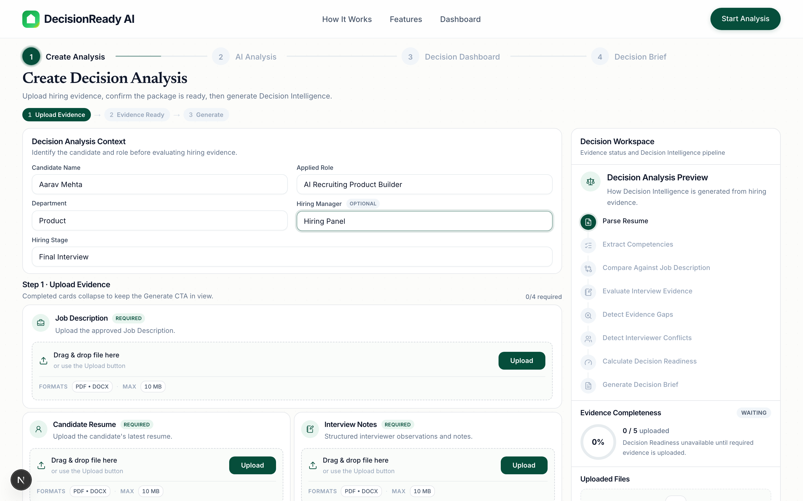
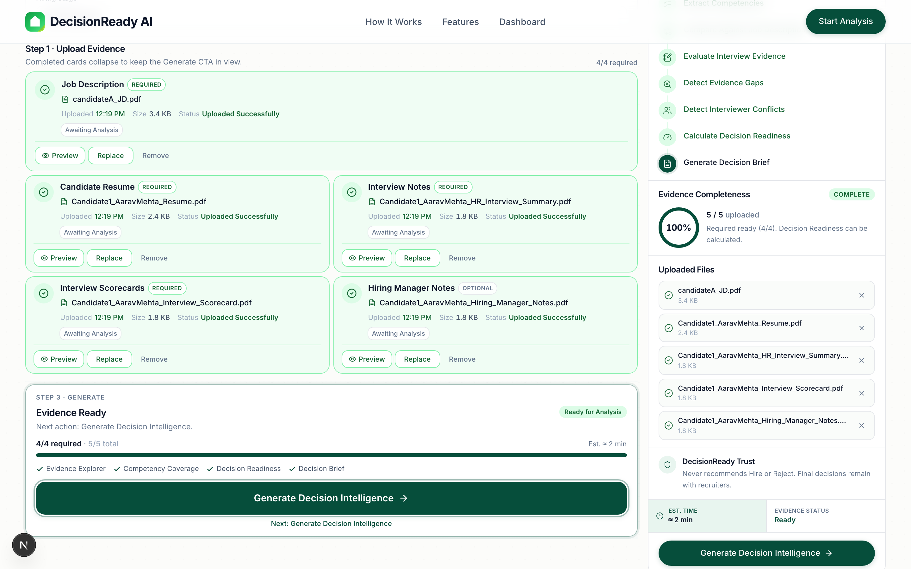
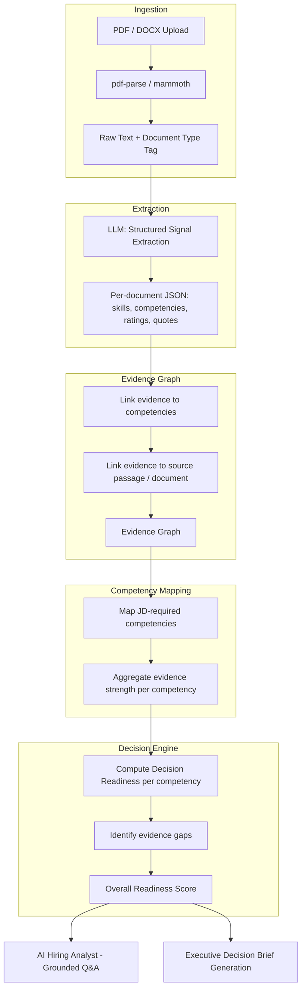
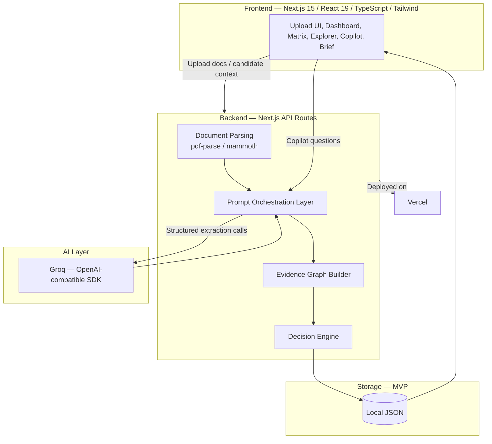
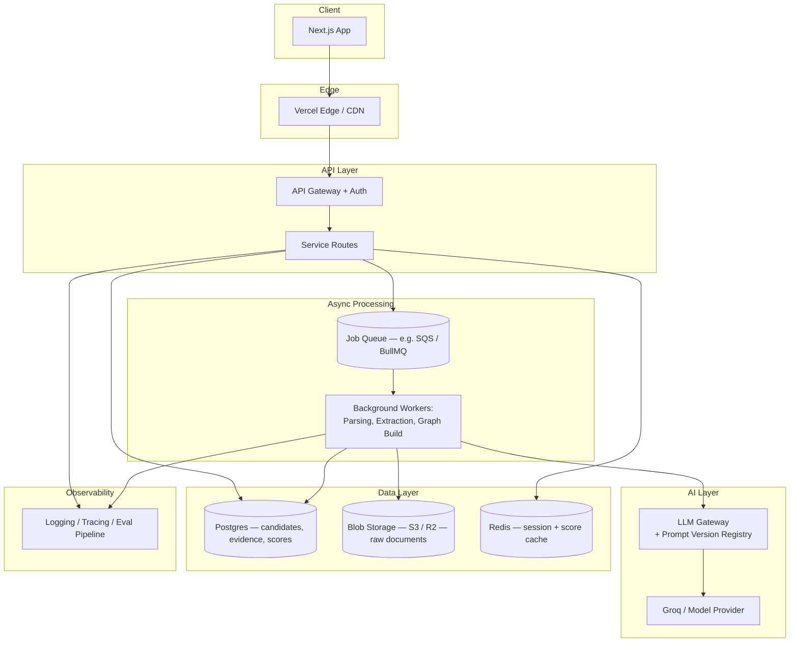

# DecisionReady AI — Product Case Study & Engineering Handoff

**AI-powered Decision Intelligence for Hiring**

[Live Demo](https://decisionready-ai.vercel.app) · [GitHub Repository](https://github.com/Rukhsar24081998/decisionready-ai)

---

## 1. Executive Summary

### Project Overview

DecisionReady AI is a decision-intelligence platform for hiring teams. It does not tell recruiters who to hire.

Instead, it looks at the evidence a hiring team has actually collected — job description, resume, interview notes, scorecards, hiring manager notes — and answers a narrower, more useful question:

> *Is there enough trustworthy evidence here to make a defensible decision?*

Most hiring tools optimize for speed of decision. This one optimizes for quality of evidence. That distinction is the entire product.

### Problem

Hiring debriefs routinely happen with incomplete, inconsistent, or contradictory evidence. Interviewers submit vague scorecards ("strong yes," no supporting detail), competencies go untested, and panels default to gut feel because nobody in the room can quickly reconstruct what was actually verified versus assumed.

The cost isn't visible at the moment of decision. It shows up months later — as a bad hire, a biased pattern no one caught, or a rejected candidate who was never fairly evaluated.

### Solution

DecisionReady AI ingests the documents a hiring loop already produces, extracts structured signals from unstructured text, builds a competency-linked evidence graph, and computes a **Decision Readiness** score.

That score answers *"can this panel proceed responsibly?"* — not *"should this panel say yes?"* Every score, gap, and flag is traceable to a specific line of evidence. Nothing is asserted without a source.

### Outcome

A working end-to-end MVP: multi-document ingestion, AI-driven extraction, an interactive evidence explorer, a grounded Q&A copilot, and a print-ready Executive Decision Brief — built and shipped solo, deployed on Vercel, and validated against a mock hiring package spanning multiple competency areas and evidence-quality scenarios.

### Role

Solo Product Manager and builder — product strategy, UX design, prompt architecture, and full-stack implementation.

### Duration

A self-directed, single-developer build, scoped and shipped as a portfolio-grade 5-day MVP rather than an incremental feature.

### Key Achievements

| Area | Achievement |
|---|---|
| Product framing | Reframed "AI hiring recommendation" (a high-risk, low-trust category) into "AI evidence sufficiency check" (a defensible, adoptable one) |
| AI architecture | Designed a five-stage pipeline (ingest → extract → graph → score → brief) with traceability built into every stage |
| Trust design | A copilot that refuses to answer anything not grounded in uploaded evidence |
| Breadth | Shipped 15+ product surfaces, from document parsing to a print-ready executive brief, as one coherent workflow |
| Positioning | Built a product that is legally and ethically safer than most "AI hiring" tools on the market, by design |

---

> ## Project at a Glance
>
> | Field | Value |
> |---|---|
> | **Project** | DecisionReady AI |
> | **Category** | AI-powered Decision Intelligence for Hiring |
> | **Duration** | 5-Day MVP |
> | **Role** | Solo Product Manager & Builder |
> | **Users** | Recruiters, Hiring Managers |
> | **Tech Stack** | Next.js, TypeScript, Tailwind CSS, Groq |
> | **Status** | MVP |
> | **Live Demo** | [decisionready-ai.vercel.app](https://decisionready-ai.vercel.app) |
> | **GitHub** | [github.com/Rukhsar24081998/decisionready-ai](https://github.com/Rukhsar24081998/decisionready-ai) |

**Figure 1 — Landing Page**

*Landing page positioning DecisionReady AI as evidence-backed Decision Intelligence for modern hiring.*

---

With the summary out of the way, it's worth spending time on the problem itself — because the product's shape only makes sense once the underlying dysfunction in the hiring loop is clear.

## 2. Problem & User

### Target Users

| Persona | Role in the hiring loop | What they need from the product |
|---|---|---|
| **Recruiter / TA Partner** | Owns the requisition, coordinates the panel, runs the debrief | A fast way to know if the panel is "debrief-ready" before scheduling the meeting |
| **Hiring Manager** | Owns the final call | A clear picture of where evidence is strong vs. thin, without wading through five documents |
| **Interviewer / Panelist** | Provides one slice of evidence | Confidence that their scorecard is actually being used, not just filed away |
| **People/TA Leadership** | Owns hiring quality and compliance | An auditable, explainable record of how a decision was reached — useful for bias review and process improvement |

### Current Hiring Workflow

A typical loop produces five to eight artifacts (JD, resume, 3–5 interview scorecards, panel notes, sometimes a take-home review) that live in five different tools — an ATS, a shared doc, Slack threads, someone's inbox. Nobody synthesizes them into one view before the debrief.

The debrief itself becomes the synthesis step, done live, under time pressure, with recency bias (the last interviewer in the room tends to dominate the conversation) and availability bias (whoever wrote the most detailed notes gets disproportionate weight).

### Pain Points

- **No pre-debrief synthesis.** Evidence exists but isn't structured before the conversation that matters most.
- **Inconsistent scorecard quality.** "Strong yes" with no example is treated the same as a detailed, competency-linked writeup.
- **Silent evidence gaps.** A competency required by the JD (e.g., "system design at scale") may never actually get tested across the loop, and nobody notices until after the offer.
- **No traceability.** Six months later, nobody can reconstruct *why* a candidate was rejected — which matters for both compliance and candidate experience.
- **ATS tools optimize the wrong layer.** They manage workflow (scheduling, status, communication) but don't touch evidence quality.

### Opportunity

Insert a lightweight, high-trust layer between "interviews are done" and "the debrief happens" — one that improves the debrief itself rather than trying to replace human judgment.

### Why Existing ATS Systems Fail Here

ATS platforms (Greenhouse, Lever, Ashby, etc.) are excellent at **process** — pipeline stages, scheduling, communication, compliance logging. They are not built to evaluate **evidence quality**.

A candidate can move through five "completed" interview stages in an ATS with scorecards that are three words long, and the system will never flag that as a problem — because from a workflow perspective, the stage is complete. DecisionReady AI intentionally doesn't compete with ATS workflow. It complements it, scoring what the ATS can't: whether the content collected is actually sufficient.

### User Personas (Primary)

**"Priya," Senior Recruiter, Series C startup.**
Runs 15+ active reqs. Wants to walk into every debrief already knowing which ones are clean and which ones will need extra facilitation. Success = fewer debriefs that end in "let's get one more signal" after the fact.

**"Marcus," Engineering Hiring Manager.**
Trusts his gut but has been burned once by a hire the panel was lukewarm on but nobody said so clearly. Wants a structured second opinion on evidence completeness — not a recommendation that overrides his judgment.

### Success Metrics

| Metric type | Metric | Why it matters |
|---|---|---|
| North Star | % of debriefs where all panelists agree the evidence presented was sufficient before discussion started | Directly measures whether the tool improves debrief quality |
| Leading | Time from "all interviews complete" to "decision brief generated" | Proxy for reduced synthesis overhead |
| Leading | % of evidence gaps flagged pre-debrief that panels acknowledge as real (not false positives) | Measures precision of the gap-detection logic |
| Trust | % of AI Hiring Analyst answers with a valid evidence citation | Directly measures hallucination rate — a trust-critical metric |
| Lagging | Reduction in "we need another interview" outcomes post-debrief | Indicates the tool is catching gaps earlier in the process |

---

Understanding the problem this clearly is what made the product's guardrails feel necessary rather than restrictive. The next section covers the vision and principles those guardrails come from.

## 3. Product Vision

### Vision

A hiring debrief where every claim on the table is backed by something someone actually observed — not a memory, not a vibe, not a LinkedIn impression.

### Mission

Give every hiring panel a structured, evidence-first view of what they actually know about a candidate before they're asked to decide anything.

### Design Principles

1. **Evidence before opinion.** The product surfaces what was observed, not what should be concluded from it.
2. **Human-in-the-loop hiring.** The decision is always made by people. The product's job ends at "here is what you know and don't know."
3. **Explainable AI.** Every score, flag, or gap must be traceable to a specific document and passage.
4. **Never recommend Hire or Reject.** A hard product constraint, enforced at both the prompt layer and the UI layer.

> **Product Philosophy in Practice.** These aren't mission-statement decoration — they shape concrete behavior. The AI Hiring Analyst is prompt-constrained to refuse recommendation-style questions and redirect to evidence instead. Decision Readiness is deliberately named "Readiness," not "Score" or "Fit," because readiness describes the evidence, not the candidate. And there is no "Approve" or "Reject" button anywhere in the product — a deliberate omission covered in full in Section 6.

### Trade-offs

| Choice | What it costs | Why it was worth it |
|---|---|---|
| No hire/reject recommendation | A "flashier" demo — recommendation engines are easier to pitch in 30 seconds | Defensible to legal, compliance, and skeptical hiring managers in a way a "should we hire them" tool never will be |
| Local JSON storage for MVP | No multi-user persistence, no real auth | Let the product prove the AI pipeline and UX before investing in infrastructure that would be premature at this stage |
| Grounded-only copilot | A noticeably more "cautious" AI experience than competitors | Removes the single biggest risk in AI-for-hiring: confidently wrong output shaping a real career decision |
| Single-tenant upload flow | Not enterprise-ready out of the box | Kept MVP scope tight enough to actually ship and evaluate end-to-end |

---

## 4. Goals & Success Metrics

### Business Goals

- Prove a defensible, adoptable wedge into the hiring-tech category — one that avoids the reputational and legal risk profile of "AI recommends candidates."
- Demonstrate a product that could plausibly sit inside an existing ATS as a debrief-readiness layer, rather than a full ATS replacement.

### User Goals

- **Recruiters:** walk into every debrief already knowing where the evidence is thin.
- **Hiring managers:** get a synthesized view of the loop in minutes, not by re-reading five documents.
- **Panelists:** know their input is structurally used, not just archived.

### North Star Metric

**% of debriefs where the panel agrees, before discussion, that the evidence presented is sufficient to proceed.**

This was chosen over more obvious candidates (like "time saved") because it ties directly to the core value proposition — decision *readiness* — rather than a generic efficiency metric any tool could claim.

### Supporting Metrics

- Evidence gap precision (flagged gaps later confirmed as real by the panel)
- Copilot grounding rate (answers with valid citations / total answers)
- Time from "interviews complete" to "brief generated"
- Competency coverage rate per loop (how many required competencies actually got evidence)

### Success Criteria for the MVP

- End-to-end flow works reliably on a realistic mock hiring package (5+ documents, multiple competency areas)
- The copilot never fabricates evidence in structured evaluation
- The Decision Brief is genuinely usable as a real debrief document — not just a technical demo output

---

Goals and metrics only mean something once you can see how a real user actually moves through the product. The next section walks the full journey, screen by screen.

## 5. User Journey

The product is structured as a linear pipeline with a non-linear exploration layer on top. Below is a walkthrough of each screen in the order a user encounters it.

```mermaid
flowchart LR
    A[Candidate Context] --> B[Document Upload]
    B --> C[Processing / Extraction]
    C --> D[Executive Hiring Profile]
    D --> E[Decision Intelligence Dashboard]
    E --> F[Evidence Intelligence Matrix]
    F --> G[Interactive Evidence Explorer]
    G --> H[AI Hiring Analyst]
    H --> I[Executive Decision Brief]
    I --> J[Print / Export]
```

### 5.1 Candidate Context

- **Purpose:** Establish who and what role this evidence bundle is about before any document is analyzed.
- **User goal:** Quickly frame the candidate and requisition.
- **Inputs:** Candidate name, role, level, team/context notes.
- **Outputs:** A context object attached to every downstream extraction and score.
- **Why this screen exists:** Without explicit context, the extraction layer has to *guess* the role's requirements from the JD alone. Capturing context up front also lets the UI personalize labels throughout ("evidence for Senior Backend Engineer" vs. generic placeholders).
- **Expected behavior:** Filled in once per candidate, in under a minute — a low-friction gate, not a form to labor over.

**Figure 2 — Candidate Context**

*Candidate context for Aarav Mehta — AI Recruiting Product Builder — with department, hiring manager, and Final Interview stage before evidence upload.*

### 5.2 Multi-Document Upload

- **Purpose:** Collect the raw evidence: JD, resume, interview notes, scorecards, hiring manager notes.
- **User goal:** Get every artifact from the loop into one place with minimal reformatting.
- **Inputs:** PDF/DOCX/text files per document type.
- **Outputs:** Parsed raw text, tagged by document type.
- **Why this screen exists:** This is the evidence intake boundary — the product's entire value depends on what's fed in here. Document *type* tagging (not just raw upload) is what lets every downstream stage reason about evidence differently.
- **Expected behavior:** Users upload what they have; the product is designed to work with partial sets and *surface the gap* rather than fail or block.

**Figure 3 — Upload Documents**

*Multi-document upload with all five Aarav Mehta hiring-package files attached (JD, resume, HR interview summary, scorecard, hiring-manager notes) and ready for Decision Intelligence generation.*

### 5.3 Processing / Extraction

- **Purpose:** Convert unstructured documents into structured signals.
- **User goal:** None directly — this is a transitional, trust-building screen ("show your work" moment).
- **Inputs:** Parsed document text.
- **Outputs:** Structured JSON per document (skills mentioned, competencies referenced, scorecard ratings, notable quotes).
- **Why this screen exists:** Making extraction visible, rather than a black-box spinner, reinforces explainability even at the UI level — users can see the system is reading their documents, not fabricating conclusions.
- **Expected behavior:** Users watch briefly, then move on — this step should feel fast and legible, not mysterious.

**Figure 4 — AI Processing**

*Explainable AI analysis pipeline showing staged evidence extraction, competency mapping, and readiness scoring.*

### 5.4 Executive Hiring Profile

- **Purpose:** Present a synthesized snapshot of the candidate derived purely from uploaded evidence.
- **User goal:** Get oriented in under 30 seconds.
- **Inputs:** Structured extraction output.
- **Outputs:** Summary card — background, role fit signals, standout evidence, notable gaps.
- **Why this screen exists:** Hiring managers arriving at a debrief need a fast orientation layer before they dig into details. This is the "front page," not the full analysis.
- **Expected behavior:** Skimmed first, referenced back to during the debrief.

**Figure 5 — Executive Hiring Profile**

*Executive Hiring Profile for Aarav Mehta synthesizing candidate summary, experience, skills, and readiness overview purely from uploaded evidence.*

### 5.5 Decision Intelligence Dashboard

- **Purpose:** Show Decision Readiness at a glance, broken down by competency.
- **User goal:** Understand *where* the evidence is strong and where it's weak, not just a single aggregate number.
- **Inputs:** Competency-mapped evidence graph.
- **Outputs:** Readiness score per competency, overall readiness indicator, flagged gaps.
- **Why this screen exists:** This is the product's core value surface — the answer to "are we ready to decide?" A single aggregate score would hide exactly the nuance that matters (e.g., strong on technical depth, untested on collaboration).
- **Expected behavior:** The primary screen referenced *during* the actual debrief meeting.

**Figure 6 — Decision Intelligence Dashboard**

*Decision Intelligence Dashboard with Decision Readiness, competency scores, overall evidence quality, and gap indicators at a glance.*

### 5.6 Evidence Intelligence Matrix

- **Purpose:** Cross-reference every required competency against every piece of evidence that speaks to it.
- **User goal:** Audit coverage — see exactly which interviewer said what about which competency.
- **Inputs:** Evidence graph + competency map.
- **Outputs:** A matrix (competencies × evidence sources) with strength indicators per cell.
- **Why this screen exists:** This is the auditability layer — the piece that makes the product defensible in a compliance or bias-review context, since it makes the *shape* of the evidence, not just its existence, visible.
- **Expected behavior:** Used selectively, mostly by recruiters or hiring leads preparing for a debrief.

**Figure 7 — Evidence Intelligence Matrix**

*Evidence Intelligence Matrix mapping competencies to document sources, strength, and coverage gaps.*

### 5.7 Interactive Evidence Explorer

- **Purpose:** Let a user click into any score or flag and see the exact underlying passage.
- **User goal:** Verify a claim (e.g., "why is 'system design' flagged as thin?") in one click.
- **Inputs:** User selection on any score/flag element.
- **Outputs:** Source passage, document of origin, extraction confidence.
- **Why this screen exists:** The literal implementation of "evidence before opinion" — nothing in the product should be a claim a user has to just trust.
- **Expected behavior:** Used reactively, whenever something surprises or concerns the user.

**Figure 8 — Interactive Evidence Explorer**

*Interactive Evidence Explorer with Product Discovery expanded, showing supporting quotes, sources, and confidence citations.*

### 5.8 AI Hiring Analyst (Grounded Q&A)

- **Purpose:** Let users ask natural-language questions about the evidence bundle.
- **User goal:** Get a fast answer to a specific question without manually searching documents.
- **Inputs:** Free-text question.
- **Outputs:** Grounded answer with citations, or an explicit refusal if the question can't be answered from evidence (or asks for a recommendation).
- **Why this screen exists:** Documents are long; a targeted question ("did anyone test their debugging process under pressure?") is often faster than browsing the matrix.
- **Expected behavior:** Used conversationally, often multiple questions in a row, right before or during a debrief.

**Figure 9 — AI Hiring Analyst**

*AI Hiring Analyst answering “What evidence supports Aarav's Product Discovery skills?” with grounded citations — never recommending Hire or Reject.*

### 5.9 Executive Decision Brief

- **Purpose:** Produce a single, shareable document synthesizing everything above.
- **User goal:** Have one artifact to open in the actual debrief meeting.
- **Inputs:** All prior structured outputs.
- **Outputs:** A formatted brief — readiness summary, competency breakdown, flagged gaps, notable evidence excerpts.
- **Why this screen exists:** All the interactive exploration in the world doesn't replace the need for one linear document a panel can read together in a live meeting.
- **Expected behavior:** Generated once per loop, opened live during the debrief.

**Figure 10 — Executive Decision Brief**

*Complete Executive Decision Brief for Aarav Mehta summarizing readiness, coverage, strengths, gaps, and evidence for the hiring debrief.*

### 5.10 Print / Export

- **Purpose:** Get the brief into a durable, shareable, non-interactive format.
- **User goal:** Attach it to the ATS record or print it for an in-person debrief.
- **Inputs:** The generated brief.
- **Outputs:** Print-optimized layout (clean typography, no interactive chrome).
- **Why this screen exists:** Not every hiring team runs debriefs from a laptop screen — a low-effort but high-utility finishing step for real-world adoption.
- **Expected behavior:** A one-time action per loop, near the end of the flow.

---

Every screen above exists because of a specific decision, not a default. The next section unpacks the reasoning behind the ones that most shaped the product — including the single most debated one.

## 6. UX Decisions

### Why upload documents first, before any AI runs?

Because evidence is the product's raw material, not a side input. Framing document upload as the *first* action — rather than a search or a candidate-lookup flow — establishes the product's mental model from the first interaction: this tool works from what you give it, not from external inference about the candidate. It also avoids a real trust and legal risk — pulling in outside data (social profiles, inferred demographic signals) that has no place in a hiring evaluation tool.

### Why capture candidate context before documents?

Two reasons, one product and one technical.

Product: it sets expectations — the user is about to evaluate a *specific* person for a *specific* role, not run a generic document summarizer. Technical: role and level context measurably improves extraction quality, because the AI knows what to look for instead of inferring level from scratch.

> **Trade-off:** this adds one extra step before the "interesting" part of the product. It was worth it — the alternative, extraction without context, produced noticeably vaguer competency mapping in early testing.

### Why the Evidence Intelligence Matrix, when the Dashboard already shows readiness?

The Dashboard answers "how ready are we, and where." The Matrix answers "show me exactly what evidence exists for every combination of competency and source." These are different jobs: one is a summary for a quick read, the other is an audit tool for someone who needs to defend the process later. Collapsing them into one screen would force every user to wade through audit-level detail just to get the readiness signal most people need most of the time.

### Why is there no "Approve," "Reject," or "Recommend" button anywhere in the product?

This is the single most deliberate UX omission in the product — and it was almost added twice during design. A recommendation button is what every stakeholder *expects* to see in a hiring tool, and its absence is a genuine usability friction point.

It stayed out for three reasons:

1. **Liability.** An AI recommendation in a hiring context creates a paper trail that can be scrutinized in an EEOC complaint or lawsuit — "the AI said reject" is a sentence no legal team wants to see in a deposition.
2. **Bias amplification.** Any recommendation model trained on historical hiring data risks encoding historical bias. A sufficiency-check model has a fundamentally smaller, more auditable surface for bias to hide in, because it's scoring *evidence completeness*, not *candidate fit*.
3. **Product durability.** "AI recommends who to hire" is a category under intense regulatory and public scrutiny (multiple U.S. states and the EU AI Act treat automated hiring decisions as high-risk). "AI checks if you have enough evidence to decide" is a fundamentally lower-risk category — one that can be sold into risk-averse enterprises without a legal review cycle killing the deal.

> **Trade-off:** the product is less immediately gratifying in a demo. It was worth it — it's the difference between a toy and something an enterprise buyer's legal team would actually approve. This is also where the product's core principles (Section 3) do the most visible work: evidence before opinion, human-in-the-loop, and explainability all converge on this one missing button.

### Why a printable report, in an AI-native product?

Because the decision doesn't happen inside the product — it happens in a meeting, often with people who never touch the tool directly (a director sitting in on a senior debrief, for instance). A polished, non-interactive artifact respects that reality instead of assuming every stakeholder will explore the dashboard themselves.

---

The UX decisions above are only trustworthy if the AI behind them is equally disciplined. The next section walks through exactly how evidence moves from a raw document to a Decision Readiness score.

## 7. AI Workflow

The AI pipeline is five stages, each with a single, narrow responsibility. This was a deliberate architectural choice — it keeps prompts focused and keeps failure modes isolated, so a bug in extraction doesn't silently corrupt scoring logic.

### 7.1 Document Ingestion

PDFs and DOCX files are parsed server-side with `pdf-parse` and `mammoth` respectively. Each document is tagged with its type (JD, resume, scorecard, notes) at upload time — this tag travels with the document through every later stage and materially changes how each downstream prompt treats the content.

### 7.2 Structured Extraction

Each document is passed to an LLM (via Groq, using an OpenAI-compatible SDK) with a prompt tuned to its document type. The output is constrained to structured JSON — skills mentioned, competencies referenced, explicit ratings (where present), and notable excerpts with their location in the source text. This is the stage where unstructured prose becomes queryable data.

### 7.3 Evidence Graph Construction

Extracted signals from every document are linked into a graph: each node is a piece of evidence, edges connect evidence to the competencies it speaks to and the source document/passage it came from. This graph is the backbone that makes every later claim traceable — the Evidence Explorer (Section 5.7) is essentially a UI on top of graph traversal.

### 7.4 Competency Mapping

The JD is parsed for required competencies, explicit and implied. Each competency is then matched against the evidence graph to see how much — and how strong — supporting evidence exists. This is where "resume mentions Python" (weak signal) is distinguished from "two interviewers independently rated system design as strong, with specific examples" (strong signal).

### 7.5 Decision Engine

For each competency, a readiness sub-score is computed from evidence coverage, source diversity (one interviewer's opinion vs. corroboration across multiple), and specificity (vague vs. detailed scorecard entries). These roll up into an overall Decision Readiness indicator, alongside an explicit list of gaps.

> **Note:** deliberately excluded from the Decision Engine is any signal derived from the candidate's background that isn't tied to a required competency — school prestige, company brand names, career gaps. These are exactly the signals most likely to introduce bias, and the engine is scoped to ignore them by design.

### 7.6 AI Hiring Analyst (Copilot)

A retrieval-constrained chat interface over the evidence graph. Every response cites its source; if a question can't be answered from the evidence graph, or asks the model to make a hire/reject judgment, the model is prompt-constrained to refuse and explain why. This behavior was tested explicitly during evaluation (Section 9).

### 7.7 Decision Brief Generation

The final stage synthesizes readiness scores, gaps, and top supporting evidence excerpts into a formatted, print-ready document. Generation is templated rather than fully freeform — the LLM fills structured sections rather than writing an open-ended narrative, which keeps output consistent and auditable across candidates.

---

A five-stage pipeline is only as good as what it runs on. The next section covers the actual technical stack behind each of those stages, plus how it would need to evolve for production.

## 8. Technical Architecture

### Current MVP Architecture

### Frontend

Next.js 15 (App Router) with React 19 and TypeScript throughout. Tailwind CSS handles styling, tuned for information density without clutter — dashboards and matrices need to show a lot of structured data legibly, which drove several component-level decisions (compact table layouts, progressive disclosure on the Evidence Explorer rather than dumping everything at once).

### Backend

Next.js API Routes serve as the backend — appropriate for MVP scope, colocated with the frontend, and sufficient for the request volume of a single-tenant demo. Each pipeline stage (Section 7) is implemented as a discrete API route rather than one monolithic endpoint, which made the pipeline far easier to debug and evaluate stage-by-stage.

### AI Layer

Groq, accessed via an OpenAI-compatible SDK, powers all extraction, mapping, and copilot calls. Prompt orchestration is centralized rather than scattered per-route, so prompt structure, output schemas, and grounding constraints live in one place.

### Parsing

`pdf-parse` and `mammoth` handle PDF and DOCX extraction respectively — lightweight, dependency-light, and sufficient for structured documents (resumes, JDs, notes) without needing OCR or layout-preservation capability.

### Storage

Local JSON for the MVP — an explicit, scoped trade-off (Section 3) to prioritize proving the AI pipeline and UX before investing in a database and auth layer that would be premature before the product's core value was validated.

### Deployment

Vercel, chosen for zero-friction Next.js deployment and fast iteration during a solo build.

### Future Production Architecture

The core architectural shift for production is moving extraction and graph-building off the request/response path and into an async job queue — document processing and multi-stage LLM orchestration should never block a user-facing request, especially as document volume per candidate grows.

---

## 9. Evaluation

Evaluation was run against a mock hiring package: a job description, a resume, three interview scorecards of varying quality (one thorough, one moderate, one deliberately vague — "strong yes, no notes"), and a set of hiring manager notes, spanning competencies including system design, collaboration, and ambiguity handling.

### What Worked

- The Decision Engine correctly identified the deliberately vague scorecard as contributing near-zero evidence weight to its associated competency, rather than treating "strong yes" as equivalent to a detailed rating.
- The Evidence Graph correctly cross-linked the same competency (system design) across two independent interviewers, and the Matrix visibly showed corroboration — exactly the signal a real panel would want to see at a glance.
- The AI Hiring Analyst consistently refused hire/reject-style questions during testing ("should we move forward with this candidate?") and instead redirected to available evidence, without needing repeated prompt tuning to enforce it.

### What Failed / Needed Iteration

- Early extraction prompts occasionally over-attributed a competency mention to a stronger rating than the source text supported (e.g., a passing mention of "worked with distributed systems" initially got scored close to an explicit strong rating). This required tightening the extraction prompt to distinguish *mentioned* from *demonstrated* evidence — a meaningful nuance that took two iterations to get right.
- The first version of the Decision Brief generation occasionally smoothed over genuine evidence gaps in its narrative phrasing, making a thin area of evidence sound more complete than the underlying scores indicated. Fixed by moving brief generation to a more rigidly templated structure (Section 7.7) instead of open narrative generation.

### Evidence Gaps (Observed in Testing)

The mock package intentionally under-tested one competency (ambiguity handling — never explicitly probed by any interviewer). The product correctly flagged this as a gap on the Dashboard and Matrix, and the AI Hiring Analyst correctly told the user "no evidence found" rather than inferring an answer from adjacent context — this was the single most important test case in the evaluation, since a false-confident answer here would undermine the entire trust model.

### Hallucination Prevention

Three layers work together:

1. **Prompt-level constraint** — the copilot's system prompt explicitly instructs it to answer only from retrieved evidence graph content and to state when evidence doesn't exist, rather than inferring.
2. **Structural constraint** — because answers are generated from graph traversal (not free retrieval over raw documents), there's a narrower surface for the model to "wander" outside grounded content.
3. **UI-level transparency** — every answer displays its source citation inline, so even in the rare case of a weak citation, the user can immediately verify it rather than trusting it blindly.

### Limitations

- The mock package testing, while deliberately varied, is not a substitute for evaluation against real, messy hiring documentation at volume — handwriting-adjacent notes, inconsistent scorecard templates, and non-English documents were out of scope for this MVP evaluation.
- Extraction quality is sensitive to document formatting; heavily tabular or non-standard scorecard templates reduced extraction confidence in informal testing.
- No formal inter-rater comparison (real recruiters independently assessing the same evidence and comparing against the product's readiness scores) was conducted — this is the natural next validation step, noted in Section 11.

### Performance Observations

Multi-document extraction for a full candidate bundle (5 documents) completed within a range acceptable for a pre-debrief prep workflow — minutes, not seconds. Acceptable for the current use case, but a clear target for the caching and async processing improvements described in Section 10.

### Lessons Learned

The biggest lesson: **the hardest part of "AI for hiring" is not scoring — it's honest abstention.** Almost every design and prompt iteration that mattered was about getting the system to correctly say "I don't know" rather than about improving positive-case scoring accuracy. That asymmetry should shape how any team building in this space allocates evaluation effort — heavily weighted toward negative/absence cases, not just typical-case accuracy.

---

The evaluation above was intentionally scoped to what a solo, five-day build could realistically validate. The MVP optimized for proving product value — that the evidence-first model works and can be trusted — rather than for production-grade infrastructure. The section below is written for the engineering team that would take this from a validated concept to a scalable, multi-tenant platform.

## 10. Engineering Handoff

### Architecture Improvements

- Move document parsing and multi-stage LLM orchestration off the synchronous request path into a background job queue (Section 8, future architecture diagram).
- Split the current API-route-per-stage structure into proper service boundaries as document volume and tenant count grow — a reasonable MVP shape today, but one that will need clearer ownership boundaries (parsing service, graph service, decision engine service) as the team grows.

### Authentication

MVP has none. Production needs standard org/user auth (e.g., NextAuth or an equivalent), with role-based access reflecting the personas in Section 2 — a hiring manager shouldn't necessarily see raw interviewer identity attached to critical scorecards, to protect panelist candor.

### Database

Move from local JSON to Postgres. Suggested core schema shape: `candidates`, `requisitions`, `documents`, `evidence_items` (graph nodes), `evidence_links` (graph edges), `competency_scores`, `briefs`. Evidence items should retain a pointer back to source document + passage offset, matching explainability at the data layer, not just the UI layer.

### Blob Storage

Raw uploaded documents (PDF/DOCX) should move to object storage (S3, R2, or equivalent) rather than being processed and discarded — retaining source documents is required for the traceability and audit story to hold up over time, and for future retraining/evaluation work.

### Queues & Background Jobs

Extraction, graph construction, and decision scoring are natural candidates for a job queue (SQS + workers, or a managed option like Inngest/Trigger.dev given the Next.js-centric stack). This directly addresses the performance limitation noted in Section 9.

### Streaming

The AI Hiring Analyst is a strong candidate for token streaming (already common with OpenAI-compatible SDKs) to reduce perceived latency in the copilot's grounded Q&A experience — not implemented in the MVP, but a low-effort, high-perceived-value addition.

### Caching

Cache computed competency scores and evidence graphs per candidate/requisition rather than recomputing on every dashboard load; invalidate on new document upload. A Redis layer alongside Postgres is the natural fit.

### Monitoring & Observability

Beyond standard infra monitoring, this product specifically needs **AI-output monitoring**: citation validity rate, refusal rate on out-of-scope questions, and extraction confidence distribution over time. These are the product's core trust metrics (Section 4) and should be first-class dashboards, not an afterthought.

### Testing

- Unit tests for the Decision Engine's scoring logic, with fixed evidence-graph fixtures.
- Golden-set regression tests for the extraction and copilot layers — the mock hiring package from Section 9 is a strong starting point for a permanent eval fixture set.
- Specific regression tests for abstention behavior (Section 9) — these matter more than typical accuracy tests for this product.

### Prompt Versioning

Every prompt (extraction, mapping, brief generation, copilot) should be versioned and stored, with score/output changes attributable to a specific prompt version — critical for debugging regressions and for any future compliance conversation about how scores are generated.

### Evaluation Framework

Formalize the manual evaluation from Section 9 into an automated eval pipeline: a growing set of labeled mock hiring packages with expected competency scores and expected gap flags, run against every prompt or model change before deployment. This is the single highest-leverage engineering investment for a product whose core value proposition is trustworthiness.

### ATS Integrations

The realistic go-to-market path (Section 3) is as a layer inside existing ATS workflows, not a replacement. Prioritize a Greenhouse or Ashby integration (webhook-based document ingestion when a stage completes) over building more standalone functionality.

### Security

Hiring evidence is sensitive personal data. Production requires encryption at rest and in transit, strict document access scoping by requisition/role, and a clear data retention and deletion policy aligned with regional employment law — this varies significantly by jurisdiction and should involve legal review before enterprise launch.

### Accessibility

The Dashboard, Matrix, and Brief all rely heavily on visual density (color-coded readiness indicators, tabular layouts) — production needs a full accessibility pass: color-contrast-independent status indicators, screen-reader-friendly table semantics, keyboard navigation through the Evidence Explorer.

### Performance

Beyond the async processing work above, the Evidence Matrix and Explorer should be evaluated for virtualization/pagination as document and competency counts scale beyond the mock package's size.

### Deployment

Vercel remains a reasonable choice for the frontend and API routes at moderate scale; background workers and any heavier processing should likely move to a separate compute environment once job queues are introduced.

---

With the infrastructure gap made explicit, it's worth laying out the order in which it would actually get closed.

## 11. Roadmap

### Phase 1 — Harden the Core Loop (0–3 months)

- Move storage to Postgres + blob storage
- Add authentication and basic role-based access
- Formalize the evaluation framework as a CI-gated eval suite
- Add streaming to the AI Hiring Analyst

### Phase 2 — Multi-Tenant & Integration Ready (3–6 months)

- Multi-tenant data model and org-level admin
- First ATS integration (Greenhouse or Ashby)
- Background job queue for processing at volume
- Prompt versioning and observability dashboards live in production

### Phase 3 — Enterprise Readiness (6–12 months)

- Formal bias-review reporting built on top of the Evidence Matrix (aggregate, anonymized views across many loops, not per-candidate)
- SOC 2-track security posture
- Configurable competency frameworks per organization
- Real inter-rater validation study against human recruiter judgment (Section 9)

### Future AI Improvements

- Fine-tuned or few-shot-optimized extraction per document type, to further reduce the "mentioned vs. demonstrated" ambiguity noted in Section 9.
- Confidence-calibrated extraction (surfacing model uncertainty explicitly in the UI, not just a binary present/absent signal).
- Cross-candidate pattern detection for panel-level calibration (e.g., "this interviewer's scorecards trend systematically higher than the panel average") — a genuinely novel evidence-quality signal, distinct from candidate scoring.

### Enterprise Roadmap

- Configurable, org-specific competency taxonomies
- SSO and enterprise identity integration
- Data residency options for regulated industries
- Formal audit-log export for compliance and legal review

---

## 12. Risks & Limitations

| Risk | Description | Mitigation |
|---|---|---|
| **Bias** | Evidence quality itself can be biased (e.g., interviewers unconsciously write more detailed notes for candidates they favor) | The product can flag *evidence asymmetry* as a process signal, but cannot fully correct for bias upstream of the data it receives |
| **Incomplete evidence** | A thin evidence bundle produces a low-confidence readiness score — correct behavior, but can be mistaken for the product "not working" | Clear UI messaging distinguishing genuinely thin evidence from an error state |
| **Parsing failures** | Non-standard document formats (scanned PDFs, unusual scorecard templates) reduce extraction quality | Fallback messaging when parsing confidence is low, rather than silently proceeding with degraded input |
| **LLM limitations** | Models can still misjudge nuance (e.g., sarcasm or hedging language in notes) despite grounding constraints | Human review remains mandatory by design — the product supports, never replaces, judgment |
| **Missing documents** | A loop with only 2 of 5 expected documents will show real gaps, but shouldn't be misread as a full assessment | Explicit "incomplete evidence set" states throughout the UI, not just a single low score |
| **Data privacy** | Hiring documents contain sensitive personal information, occasionally protected-class-adjacent context | Requires legal review, data minimization, and retention policy before any production/enterprise deployment |
| **Scalability** | Current MVP architecture (local JSON, synchronous processing) does not scale past single-tenant demo use | Addressed directly in the production architecture and Phase 1–2 roadmap |

---

## 13. Key Learnings

### Product Lessons

- The most defensible AI products in high-stakes domains are often the ones that do *less* than users initially expect — refusing to recommend was, counterintuitively, the product's strongest differentiator.
- Naming matters more than it seems: "Decision Readiness" versus "Fit Score" changed how every subsequent design decision got evaluated.

### UX Lessons

- Making AI reasoning visible builds more trust than making it fast. Users tolerated a visible "processing" step far better than they would have tolerated a fast but opaque result.
- A single aggregate score is almost always the wrong default for a high-stakes decision-support tool — breaking readiness down per competency was a late but important pivot from an earlier single-score design.

### AI Lessons

- Grounding and refusal behavior needed far more design and testing attention than positive-case accuracy — an inversion of where effort typically goes in AI product development.
- The distinction between "mentioned" and "demonstrated" in extraction is a small-sounding NLP nuance with outsized product consequences in a domain where every score needs to be defensible.

### Technical Lessons

- Keeping each pipeline stage as a discrete, independently testable unit paid off directly during evaluation — isolating failures to a specific stage made debugging dramatically faster than a more tightly coupled pipeline would have allowed.
- Scoping storage to "local JSON for now" was the right MVP call — it kept focus on validating the AI pipeline and UX rather than prematurely building infrastructure for a scale the product hadn't earned yet.

---

## 14. Conclusion

DecisionReady AI started from a narrow, almost contrarian bet: that the most valuable thing an AI hiring product could do is refuse to make the recommendation everyone assumes it should make.

Building the product around evidence sufficiency rather than candidate scoring shaped every downstream decision — the absence of a recommend button, the structure of the Decision Engine, the copilot's refusal behavior — and consistently held up as the right call through evaluation. Evidence before opinion, human-in-the-loop, and explainability weren't just principles on a slide; they were the actual filter every feature had to pass through.

**With another three months, three things would be the priority:**

1. **Real inter-rater validation.** Running the product against real (anonymized) hiring loops alongside human recruiter judgment, to see whether the readiness scores and flagged gaps actually match what experienced practitioners would independently flag. This is the single most important unproven assumption in the current MVP.
2. **The evaluation framework as a first-class product, not a testing afterthought.** Given how much of this product's value is *trustworthiness*, an automated, continuously growing eval suite deserves the same engineering investment as any user-facing feature.
3. **One real ATS integration**, even a narrow one, to test the "layer inside existing workflow" go-to-market thesis against reality rather than assumption. A standalone tool, however well-designed, only proves the product works — an integration would prove it fits into how hiring teams actually operate.

---

## Document Revision Summary

**What was improved**

- Added a "Project at a Glance" summary table immediately after the Executive Summary, plus a Landing Page screenshot, so recruiters can orient in seconds.
- Inserted live product screenshots at every major screen in the User Journey (candidate context, upload, processing, profile, dashboard, matrix, explorer, analyst, brief), captured from the Aarav Mehta mock hiring package.
- Broke up several long paragraphs (Executive Summary, Problem, UX Decisions) into shorter blocks and pulled key claims into blockquotes for scannability.
- Reduced repeated explanations of the four core ideas — no hire/reject recommendation, human-in-the-loop, explainability, evidence-first. The full reasoning now lives in Product Vision (Section 3), UX Decisions (Section 6), and the Conclusion (Section 14); other sections reference them briefly instead of re-explaining them.
- Added transition paragraphs between major sections (Executive Summary → Problem, Problem → Vision, Vision → User Journey, User Journey → UX Decisions, UX Decisions → AI Workflow, AI Workflow → Technical Architecture, Evaluation → Engineering Handoff, Engineering Handoff → Roadmap) so the document reads as one continuous case study rather than isolated chapters.
- Added a short framing paragraph before Section 10 clarifying that the MVP intentionally optimized for validating product value over production infrastructure, and that the Engineering Handoff section is the bridge from validated concept to scalable platform.

**What was intentionally left unchanged**

- All product decisions, trade-offs, evaluation findings, and technical architecture — nothing about the product itself was altered.
- All Mermaid diagrams, kept exactly as originally structured.
- The full depth of the Engineering Handoff and UX Decisions sections — these are the sections most likely to be read closely by engineering managers and senior engineers, so they were edited for clarity only, never shortened.
- The overall document length and section structure (14 numbered sections) — this pass was a readability and presentation edit, not a content rewrite.

**Why**

The goal of this pass was to make an already-accurate, already-comprehensive case study easier to *read* — for a recruiter skimming in two minutes and for an engineer reading closely in twenty — without softening any of the product reasoning, trade-offs, or technical depth that make the document credible in the first place.
