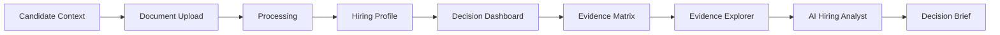
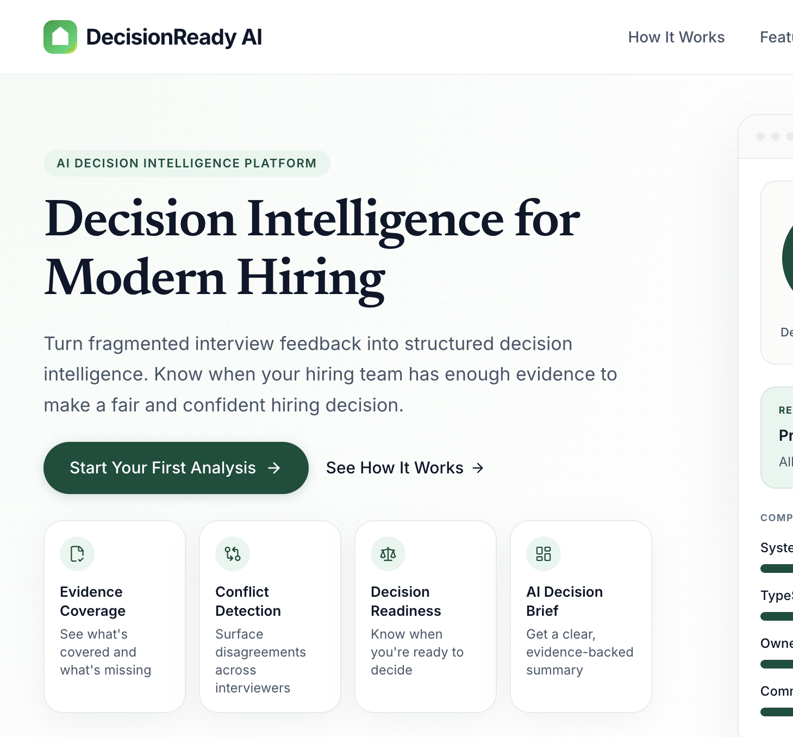
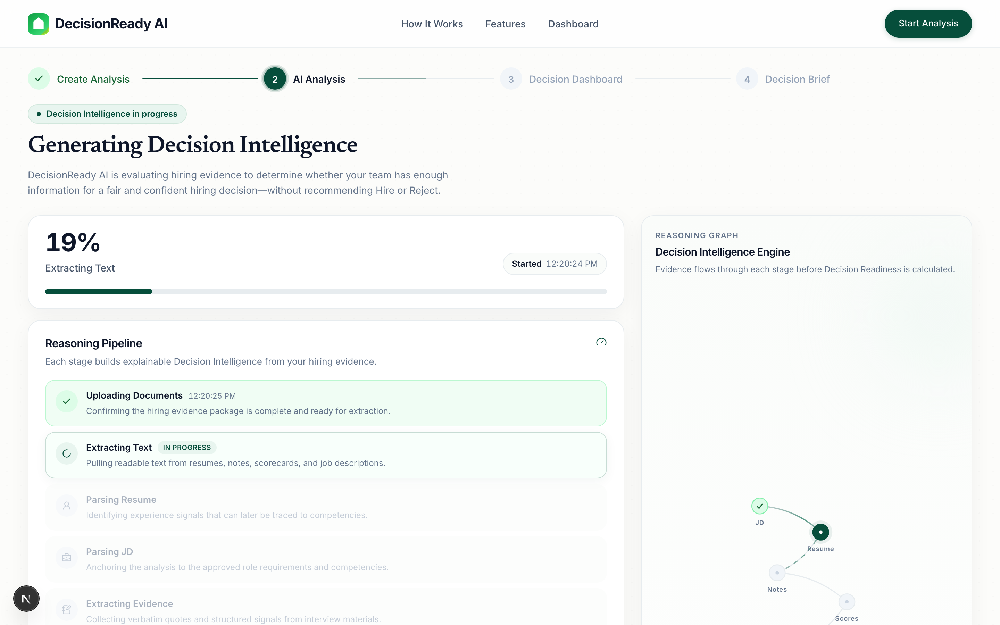
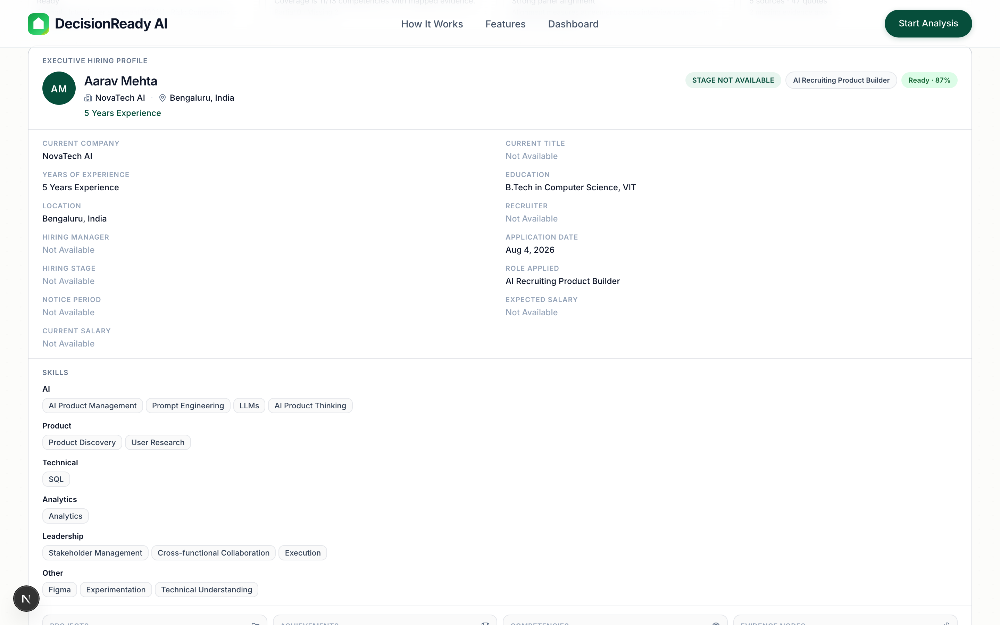
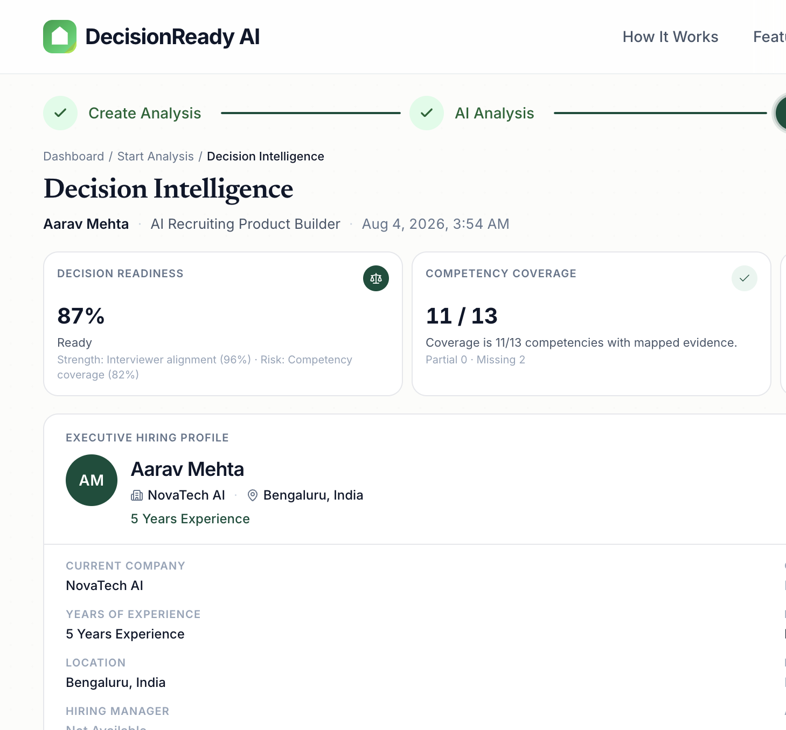
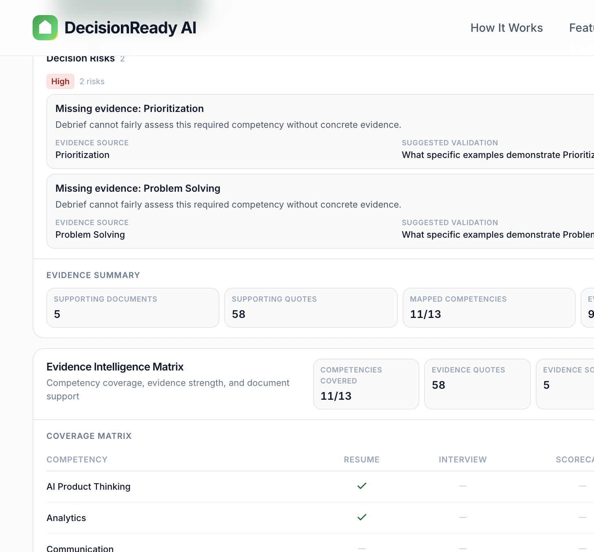
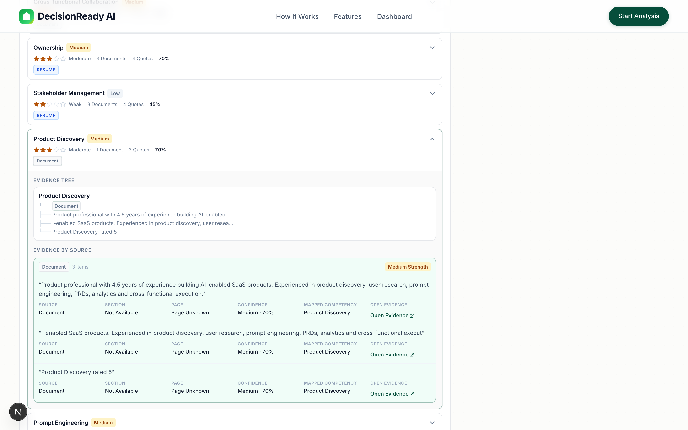
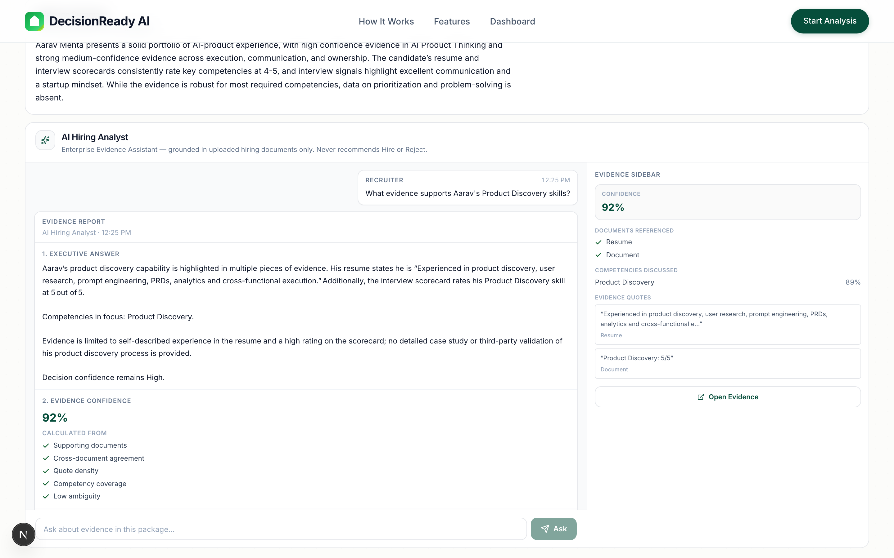
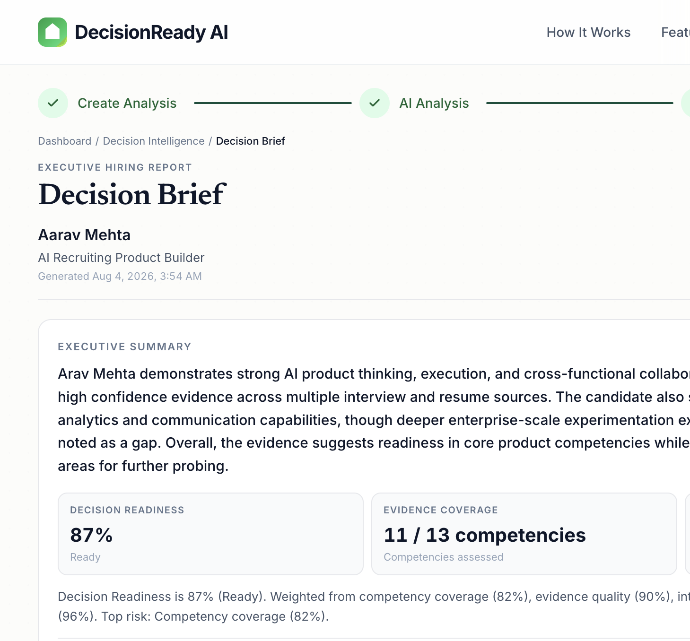

# DecisionReady AI

## Executive Summary

DecisionReady AI is an AI-powered decision-intelligence platform for hiring teams. It does not recommend who to hire. Instead, it reviews the evidence a hiring loop has already collected — job description, resume, interview notes, scorecards, and hiring manager notes — and answers a narrower question: *Is there enough trustworthy evidence to make a defensible decision?*

Hiring debriefs often happen with fragmented, incomplete, or contradictory evidence. Interviewers submit vague scorecards, required competencies go untested, and panels default to gut feel because nobody can quickly see what was verified versus assumed. DecisionReady AI is built for **Recruiters, Hiring Managers, and Interviewers** who need to know whether a panel is debrief-ready before the meeting starts.

Unlike ATS products that optimize workflow (scheduling, stages, status), this MVP scores **evidence quality** — Decision Readiness per competency, with gaps and citations. It never recommends Hire or Reject — that reduces liability and bias risk, and keeps human judgment central. The product’s job ends at “here is what you know and don’t know.”

The working MVP is powered by **Next.js, React, TypeScript, Tailwind CSS, Groq, and Vercel**, and was evaluated end-to-end against a realistic mock hiring package (Aarav Mehta) spanning multiple document types and intentional evidence-quality scenarios.

> **Project Outcome**
>
> ✓ Working AI-powered MVP  
> ✓ Live deployment on Vercel  
> ✓ Tested using realistic mock hiring documents  
> ✓ Complete engineering handoff for future development

## Prototype at a Glance

| Field | Value |
|-------|-------|
| Project | DecisionReady AI |
| Category | AI Decision Intelligence for Hiring |
| Built For | Recruiters, Hiring Managers, Interviewers |
| Problem Solved | Fragmented hiring evidence before debrief |
| Core Innovation | Decision Readiness instead of Hire/Reject |
| Tech Stack | Next.js, React, TypeScript, Tailwind CSS, Groq, Vercel |
| Prototype | Working MVP |
| Duration | 5-Day MVP |
| Evaluation | Tested using realistic mock hiring documents |
| Live Demo | https://decisionready-ai.vercel.app |
| GitHub | https://github.com/Rukhsar24081998/decisionready-ai |

**Live Demo:** [https://decisionready-ai.vercel.app](https://decisionready-ai.vercel.app)

**GitHub:** [https://github.com/Rukhsar24081998/decisionready-ai](https://github.com/Rukhsar24081998/decisionready-ai)

**Tech Stack:** Next.js 15 · React 19 · TypeScript · Tailwind CSS · Groq · Zod · Vercel

---

# 1. The Problem & User

## The hiring workflow problem

A typical hiring loop produces five to eight artifacts — JD, resume, interview scorecards, panel notes, sometimes a take-home review — scattered across an ATS, shared docs, Slack, and email. Nobody synthesizes them before the debrief.

The debrief becomes the synthesis step: live, under time pressure, shaped by recency bias (the last interviewer dominates) and availability bias (whoever wrote the most detailed notes carries the room). Incomplete or contradictory evidence is easy to miss until after an offer — or after a bad hire.

## Why current ATS tools fail here

ATS platforms (Greenhouse, Lever, Ashby, etc.) excel at **process**: pipeline stages, scheduling, communication, compliance logging. They are not built to evaluate **evidence quality**.

A candidate can clear five “completed” interview stages with three-word scorecards, and the ATS will never flag that as a problem — the stage is complete from a workflow perspective. DecisionReady AI does not compete with ATS workflow. It complements it by scoring what the ATS cannot: whether the content collected is actually sufficient.

## Target users

| Persona | Role in the loop | What they need |
|-------|------------------|----------------|
| **Recruiter / TA Partner** | Owns the req, coordinates the panel, runs the debrief | Know if the panel is debrief-ready before the meeting |
| **Hiring Manager** | Owns the final call | See where evidence is strong vs. thin without re-reading five docs |
| **Interviewer / Panelist** | Provides one slice of evidence | Confidence their scorecard is used, not just filed |
| **People / TA Leadership** | Owns hiring quality and compliance | An auditable record of how a decision was supported |

**Primary personas**

- **Priya, Senior Recruiter** — Runs 15+ active reqs. Wants to walk into every debrief knowing which loops are clean and which need facilitation. Success = fewer “let’s get one more signal” outcomes after the fact.
- **Marcus, Engineering Hiring Manager** — Trusts judgment but has been burned by lukewarm consensus nobody stated clearly. Wants a structured second opinion on evidence completeness — not a recommendation that overrides him.

## User pain points

- **No pre-debrief synthesis** — Evidence exists but isn’t structured before the conversation that matters most.
- **Inconsistent scorecard quality** — “Strong yes” with no example is treated like a competency-linked writeup.
- **Silent evidence gaps** — A JD-required competency may never get tested; nobody notices until after the offer.
- **No traceability** — Months later, nobody can reconstruct *why* a candidate was advanced or rejected.
- **Wrong optimization layer** — ATS tools manage workflow, not evidence quality.

## Product opportunity

Insert a lightweight, high-trust layer between “interviews are done” and “the debrief happens” — one that improves the debrief rather than replacing human judgment.

> **Core bet:** The most valuable thing an AI hiring product can do is refuse to make the recommendation everyone expects — and instead prove whether the panel has enough evidence to decide responsibly.

---

# 2. The Solution & UX

The product is a linear intake → intelligence → brief pipeline, with exploration (matrix, explorer, copilot) layered on top for debrief prep.

---

## Figure 1 — Landing Page

**Purpose**  
Position DecisionReady AI as evidence-backed Decision Intelligence — not an AI hiring recommender.

**What the user does**  
Orients on the product promise and enters the workflow (new Decision Analysis / dashboard).

**What AI does**  
Nothing yet. This screen establishes the mental model before any documents or models run.

**Why this screen matters**  
First impression sets expectations: the product checks evidence sufficiency, not candidate fit.

**Product decision**  
Lead with Decision Intelligence and evidence quality, not “AI recommends candidates.” That framing reduces legal and trust risk from the first click.

---

## Figure 2 — Candidate Context

**Purpose**  
Frame who and what role this evidence bundle is about before analysis.

**What the user does**  
Enters candidate name, role, department, hiring manager, and hiring stage (under a minute).

**What AI does**  
Uses this context later to ground extraction and personalize labels — it does not invent candidate facts here.

**Why this screen matters**  
Without context, extraction must guess role requirements from the JD alone. Explicit context improves mapping quality and keeps the loop about a specific person and role.

**Product decision**  
Accept one extra step before “interesting” AI. Early tests without context produced vaguer competency mapping; the trade-off was worth it.

---

## Figure 3 — Upload Documents

**Purpose**  
Collect the raw evidence: JD, resume, interview notes, scorecards, hiring manager notes.

**What the user does**  
Uploads PDF/DOCX/text files and tags document type. Partial sets are allowed.

**What AI does**  
Does not run yet. Intake prepares typed text for the pipeline; gaps are expected to surface later, not block upload.

**Why this screen matters**  
This is the evidence boundary. Everything downstream depends on what enters here — and on document *type*, not just raw files.

**Product decision**  
Upload first, before any AI. Establishes “this tool works from what you give it,” avoids pulling external profiles or inferred demographic signals, and keeps the product legally safer.

---

## Figure 4 — AI Processing

**Purpose**  
Convert unstructured documents into structured signals — visibly, not as a black box.

**What the user does**  
Watches staged progress (extraction → competency mapping → readiness scoring), then continues.

**What AI does**  
Parses documents, extracts skills/competencies/ratings/quotes into structured JSON, builds the evidence graph, and computes readiness inputs.

**Why this screen matters**  
A visible pipeline builds trust: users see the system reading their documents, not fabricating conclusions.

**Product decision**  
Prefer an explainable “show your work” step over a fast opaque spinner. In testing, users tolerated visible processing better than instant unexplained results.

---

## Figure 5 — Executive Hiring Profile

**Purpose**  
Give a 30-second orientation snapshot derived only from uploaded evidence.

**What the user does**  
Skims background, experience, skills, and readiness overview before diving deeper.

**What AI does**  
Synthesizes extraction output into a summary card — standout evidence and notable gaps, never a hire/reject call.

**Why this screen matters**  
Hiring managers need a front page before detail. This is orientation, not the full analysis.

**Product decision**  
Keep profile evidence-only. No outside enrichment. Summary supports judgment; it does not replace it.

---

## Figure 6 — Decision Intelligence Dashboard

**Purpose**  
Answer “are we ready to decide?” with Decision Readiness broken down by competency.

**What the user does**  
Reviews overall readiness, per-competency scores, evidence quality, and flagged gaps — typically during debrief prep or live.

**What AI does**  
Aggregates the evidence graph into readiness indicators and gap flags from coverage, source diversity, and specificity.

**Why this screen matters**  
This is the core value surface. A single aggregate number would hide the nuance that matters (e.g., strong technical depth, untested collaboration).

**Product decision**  
Name it **Decision Readiness**, not Fit Score. Readiness describes evidence, not the candidate. Break scores down per competency rather than one headline number.

---

## Figure 7 — Evidence Intelligence Matrix

**Purpose**  
Cross-reference every required competency against every evidence source that speaks to it.

**What the user does**  
Audits coverage — which interviewer said what about which competency, and where cells are thin.

**What AI does**  
Maps graph nodes into a competencies × sources matrix with strength/coverage indicators.

**Why this screen matters**  
Auditability for compliance and bias review: the *shape* of evidence is visible, not just its existence.

**Product decision**  
Keep Matrix separate from Dashboard. Dashboard = quick readiness; Matrix = audit depth. Collapsing them forces everyone through detail most users don’t need every time.

---

## Figure 8 — Evidence Explorer

**Purpose**  
Click any score or flag and see the exact supporting passage.

**What the user does**  
Expands a competency (e.g., Product Discovery) to verify quotes, sources, and confidence.

**What AI does**  
Surfaces linked excerpts and citations from the evidence graph — no new claims without a source.

**Why this screen matters**  
Literal implementation of “evidence before opinion.” Nothing should be a claim users must take on faith.

**Product decision**  
Progressive disclosure over dumping all quotes at once. Verification is reactive: used when something surprises or concerns the user.

---

## Figure 9 — AI Hiring Analyst

**Purpose**  
Answer natural-language questions about the evidence bundle with citations.

**What the user does**  
Asks targeted questions (e.g., “What evidence supports Product Discovery?”) before or during debrief.

**What AI does**  
Retrieves from the evidence graph, answers with citations, or refuses if evidence is missing or the question asks for Hire/Reject.

**Why this screen matters**  
Faster than browsing long docs for a specific probe. Trust depends on honest abstention, not fluent guessing.

**Product decision**  
Grounded-only copilot. Prompt- and UI-constrained to refuse recommendation-style questions and redirect to evidence. Cautious by design.

---

## Figure 10 — Executive Decision Brief

**Purpose**  
Produce one shareable, print-ready artifact for the live debrief.

**What the user does**  
Opens the brief in the meeting, attaches it to the ATS record, or prints it.

**What AI does**  
Fills templated sections (readiness, coverage, strengths, gaps, excerpts) — not an open-ended narrative that can smooth over thin evidence.

**Why this screen matters**  
Interactive exploration doesn’t replace one linear document a panel can read together. Not every stakeholder opens the dashboard.

**Product decision**  
Ship a printable brief in an AI-native product. Decisions happen in meetings; a durable artifact respects that reality. Templated generation was required after freeform drafts overstated gaps.

---

# 3. Evaluation

Evaluation used the **Aarav Mehta** mock hiring package (AI Recruiting Product Builder role).

> *This evaluation was conducted using a synthetic hiring package created solely for demonstration purposes. No real candidate data was used.*

## Documents used

- Job description
- Resume
- HR interview summary
- Interview scorecard(s) of varying quality (thorough → deliberately vague “strong yes, no notes”)
- Hiring manager notes

Competencies spanned areas such as product discovery, system design, collaboration, and ambiguity handling — including intentional under-testing of at least one competency.

## Workflow tested

Full path: Candidate Context → Upload → Processing → Profile → Dashboard → Matrix → Explorer → AI Hiring Analyst → Decision Brief.

## What worked well

- Vague “strong yes” scorecards received near-zero evidence weight instead of counting as strong ratings.
- Corroboration across interviewers (e.g., same competency, two sources) appeared clearly on the Matrix.
- AI Hiring Analyst consistently refused hire/reject questions and redirected to evidence.
- Intentionally untested competency (ambiguity handling) was flagged as a gap; the Analyst answered “no evidence found” instead of inferring from adjacent context — the most important trust test.

## Known limitations

- Mock-package testing is not a substitute for volume testing on messy real docs (scanned PDFs, inconsistent templates, non-English).
- Extraction quality is sensitive to formatting; tabular/non-standard scorecards reduce confidence.
- No formal inter-rater study vs. real recruiters yet.
- Multi-document runs take minutes (acceptable for pre-debrief prep; target for async/caching later).

## Potential AI bias

- Upstream interviewers may write more detail for favored candidates; the product can surface evidence asymmetry but cannot fully correct bias in source writing.
- The Decision Engine deliberately ignores prestige signals (school, brand names, career gaps) not tied to required competencies — reducing a common bias channel by design.
- Historical “fit” models are avoided entirely; scoring evidence completeness has a smaller, more auditable bias surface than scoring candidates.

## Failure cases / iterations

| Failure | Fix |
|--------|-----|
| Over-attributing “mentioned” skills as “demonstrated” | Tightened extraction prompts to distinguish mention vs. demonstration |
| Brief narrative smoothed over real gaps | Moved brief generation to rigid templates |
| (Risk) Confident answers when evidence missing | Abstention + citation UI; tested as primary negative case |

## What human review is still required

- Final hire/advance/reject judgment
- Interpreting soft interpersonal nuance the model may miss
- Confirming flagged gaps are real process gaps vs. acceptable trade-offs
- Legal/compliance review of any production deployment handling candidate PII

| Strength | Limitation |
|----------|------------|
| Clear Decision Readiness + per-competency gaps | Not validated at real hiring volume |
| Traceable citations on scores and copilot answers | Formatting-sensitive extraction |
| Honest abstention on missing evidence / hire-reject asks | No inter-rater study yet |
| Distinguishes vague vs. detailed scorecards | Sync processing latency on full bundles |
| Bias surface limited to evidence sufficiency | Cannot fix biased note-taking upstream |

---

# 4. Next Steps for Engineers

Handoff for taking a validated MVP to a multi-tenant platform. Prefer product-safe evolution over rewrite.

## Architecture overview

| Layer | MVP today | Direction |
|-------|-----------|-----------|
| Frontend | Next.js App Router, React 19, TypeScript, Tailwind | Keep; add a11y pass on dense views |
| Backend | Next.js API routes per pipeline stage | Clearer service boundaries as volume grows |
| AI | Groq via OpenAI-compatible SDK; central prompt orchestration | Prompt version registry + eval gates |
| Parsing | `pdf-parse` / `mammoth` | Keep; soft-fail on low parse confidence |
| Storage | Durable analysis store (Blob when configured; local JSON in dev) | Postgres + object storage for documents |
| Deploy | Vercel | Frontend/API on Vercel; workers elsewhere when queues land |

## AI pipeline (five stages)

1. **Ingest** — Parse PDF/DOCX; tag document type
2. **Extract** — Typed LLM calls → structured JSON (skills, competencies, ratings, quotes)
3. **Evidence graph** — Link signals to competencies + source passages
4. **Competency map** — JD requirements vs. evidence strength/diversity
5. **Decision engine** — Per-competency readiness, gaps, overall readiness → Brief + Analyst

Keep stages narrow and separately testable so extraction bugs cannot silently corrupt scoring.

## Prompt flow

- Document-type-specific extraction prompts → constrained JSON schemas (Zod)
- Mapping / readiness logic over the graph
- Copilot: retrieval-constrained; refuse hire/reject and unanswered questions
- Brief: templated section fill, not freeform narrative

Version every prompt; attribute score changes to prompt versions.

## Key APIs (conceptual)

| Surface | Role |
|--------|------|
| Analyze / generate intelligence | Ingest docs → run pipeline → persist analysis |
| Analyses CRUD / restore | Load dashboard & intelligence views across instances |
| Copilot | Grounded Q&A over stored evidence |
| Brief data | Server-assembled brief for print/export |

## Storage

- Analyses must survive across serverless instances (production Blob / durable store).
- Retain raw documents in object storage for audit and re-eval.
- Suggested entities: candidates, requisitions, documents, evidence items/links, competency scores, briefs — with passage pointers for explainability.

## Known technical limitations

- Sync multi-stage LLM work on the request path
- MVP auth/RBAC not production-grade
- Dense Matrix/Explorer need virtualization at larger competency counts
- AI trust metrics (citation validity, refusal rate) need first-class monitoring

## Future roadmap

| Phase | Focus |
|-------|-------|
| **0–3 mo** | Postgres + blob docs, auth/RBAC, CI eval suite, copilot streaming |
| **3–6 mo** | Multi-tenant, first ATS integration (Greenhouse/Ashby), job queue, prompt observability |
| **6–12 mo** | Aggregate bias-review views, SOC 2 track, org competency frameworks, inter-rater study |

## Deployment considerations

- Hiring docs are sensitive PII — encryption, retention/deletion policy, legal review before enterprise.
- Keep human-in-the-loop and no hire/reject as hard product constraints in prompts and UI.
- Gate model/prompt changes on golden-set evals (abstention cases weighted heavily).
- Background workers for parse/extract/graph once volume exceeds demo scale.

---

# Product Decisions

| Decision | Why |
|----------|-----|
| **Never recommend Hire / Reject** | Liability, bias amplification, and regulatory risk. “Evidence sufficient?” is safer and more adoptable than “AI said reject.” Enforced in prompts and UI — no Approve/Reject button. |
| **Evidence quality over decision speed** | Bad hires and unfair rejects come from thin evidence, not from slow tools. Optimize the layer ATS ignores. |
| **Confidence / readiness scoring** | Panels need to know *where* evidence is strong or thin. Per-competency readiness beats a single opaque “fit” number. |
| **Human judgment stays central** | Product job ends at “here is what you know and don’t know.” Final call remains with people. |
| **Upload + context before AI** | Works only from provided evidence; avoids external inference; improves extraction. |
| **Dashboard ≠ Matrix** | Summary vs. audit are different jobs; don’t force every user through both. |
| **Printable Decision Brief** | Decisions happen in meetings with stakeholders who never open the app. |
| **Grounded-only Analyst** | Hallucinated hiring answers are career-impacting; refusal is a feature. |

---

# Key Learnings

- The most defensible AI products in high-stakes domains often do *less* than users expect — refusal to recommend became the strongest differentiator.
- Naming matters: “Decision Readiness” vs. “Fit Score” changed how every later design choice was judged.
- Visible AI reasoning builds more trust than raw speed.
- A single aggregate score is the wrong default for high-stakes decision support; per-competency breakdown was essential.
- Honest abstention needed more design and test effort than positive-case accuracy.
- “Mentioned” vs. “demonstrated” is a small NLP distinction with outsized product consequences.
- Discrete, testable pipeline stages made evaluation and debugging far faster.
- Scoping storage lightly for MVP was correct — prove the AI/UX loop before premature infrastructure.

---

*DecisionReady AI demonstrates how AI can strengthen hiring by improving evidence quality rather than replacing human judgment. The prototype validates the concept through a working implementation, realistic evaluation, and a practical engineering handoff that can guide future product development.*

*DecisionReady AI — Product Case Study & Engineering Handoff · 5-Day MVP*
