# DecisionReady AI

**AI-powered hiring intelligence that turns resumes, interview notes, scorecards, and hiring documents into evidence-backed Decision Readiness—never Hire or Reject.**

[](https://nextjs.org/)
[](https://react.dev/)
[](https://www.typescriptlang.org/)
[](https://tailwindcss.com/)
[](https://groq.com/)

---

## Table of Contents

- [Overview](#overview)
- [Features](#features)
- [Product Workflow](#product-workflow)
- [Screenshots](#screenshots)
- [Tech Stack](#tech-stack)
- [Architecture](#architecture)
- [Folder Structure](#folder-structure)
- [Running Locally](#running-locally)
- [Environment Variables](#environment-variables)
- [Future Roadmap](#future-roadmap)
- [Limitations](#limitations)
- [Author](#author)

---

## Overview

**DecisionReady AI** is a Decision Intelligence layer for modern hiring. Recruiters and hiring managers upload the evidence they already collect—job descriptions, resumes, interview notes, scorecards, and hiring-manager notes—and the product answers one question:

> **Do we have enough evidence to make a fair and confident hiring decision?**

Traditional ATS workflows store documents and comments, but they rarely make evidence completeness, conflicts, and competency coverage legible before debrief. Teams still scroll through fragmented notes, reconcile inconsistent scorecards, and enter calibration meetings without a shared picture of what is known versus missing.

DecisionReady AI closes that gap by:

- Extracting structured signals from uploaded hiring documents
- Mapping evidence to role competencies with citations
- Computing **Decision Readiness** from coverage, quality, alignment, and completeness
- Presenting an executive dashboard, evidence explorer, recruiter copilot, and printable Decision Brief

Hiring decisions stay with people. The product evaluates the **evidence substrate**—not whether a candidate should be hired.

---

## Features

Implemented in the current MVP:

| Capability | What it does |
|---|---|
| **Multi-document upload** | Upload JD (required), resume, interview notes, interview scorecards, and hiring-manager notes (PDF / DOCX) |
| **Candidate context** | Capture candidate name, role, department, hiring manager, and hiring stage before analysis |
| **Resume extraction** | Parse experience, skills, and candidate context from the resume |
| **Job Description analysis** | Treat the JD as the requirement authority and extract target competencies |
| **Interview notes analysis** | Extract qualitative evidence and interviewer signals from notes |
| **Interview scorecards** | Pull structured scores and comments into the evidence graph |
| **Hiring manager notes** | Include HM perspective as an evidence source when provided |
| **Evidence Graph** | Merge document-level extractions into a competency-linked evidence graph with citations |
| **Competency mapping** | Map quotes and signals to competencies without inventing evidence |
| **Decision Readiness** | Deterministic readiness score and label (Ready / Partially Ready / Not Ready) |
| **Executive Hiring Profile** | Shared candidate presentation model (company, title, location, experience, skills) |
| **Decision Intelligence Dashboard** | KPIs, scorecard, strengths, gaps, alignment, and processing summary |
| **Evidence Intelligence Matrix** | Coverage matrix across resume / interview / scorecard sources |
| **Interactive Evidence Explorer** | Search, filter, and inspect competency → quote → document mappings |
| **AI Hiring Analyst** | Recruiter copilot grounded in the uploaded package; structured answers with citations |
| **Executive Decision Brief** | Debrief-ready report with summary, strengths, gaps, discussion topics, and appendix |
| **Print report** | Browser print (`window.print`) for dashboard and Decision Brief handoff |

---

## Product Workflow

```text
┌─────────────────┐     ┌──────────────────┐     ┌─────────────────────┐
│  Create Analysis │────▶│  Upload Evidence  │────▶│ Confirm Package Ready│
│  + Candidate Ctx │     │  JD · Resume · …  │     │                     │
└─────────────────┘     └──────────────────┘     └──────────┬──────────┘
                                                             │
                                                             ▼
┌─────────────────┐     ┌──────────────────┐     ┌─────────────────────┐
│ Decision Brief  │◀────│ Intelligence Dash │◀────│ AI Analysis Pipeline │
│ + Print Report  │     │ Profile · Matrix  │     │ Extract → Graph →    │
│                 │     │ Explorer · Copilot│     │ Decision Engine      │
└─────────────────┘     └──────────────────┘     └─────────────────────┘
```

---

## Screenshots

### Landing Page

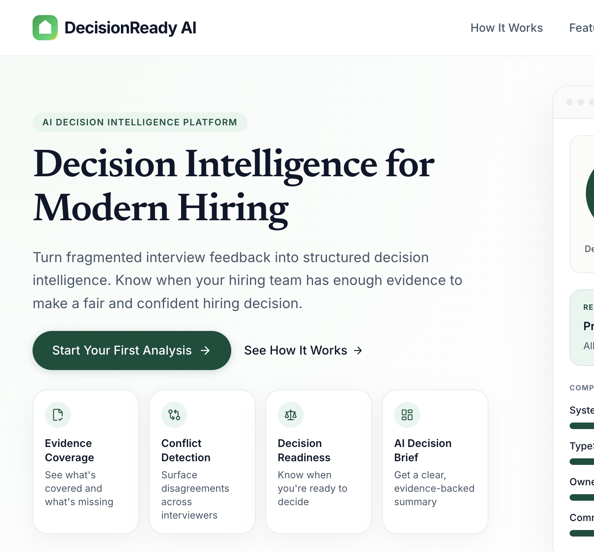

### Candidate Context

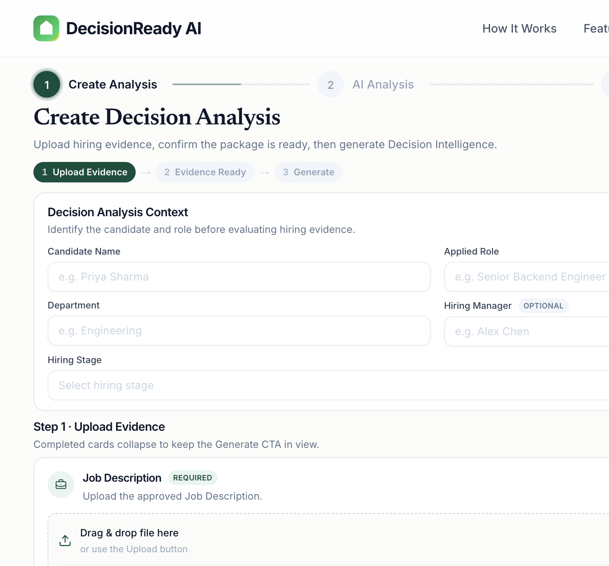

### Upload Documents

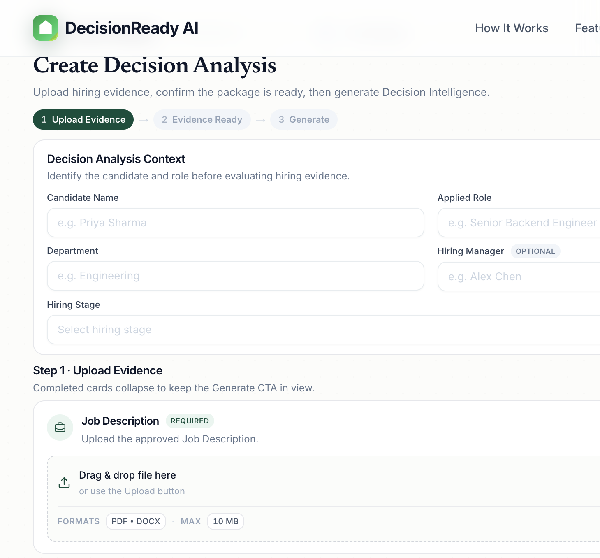

### AI Analysis Progress

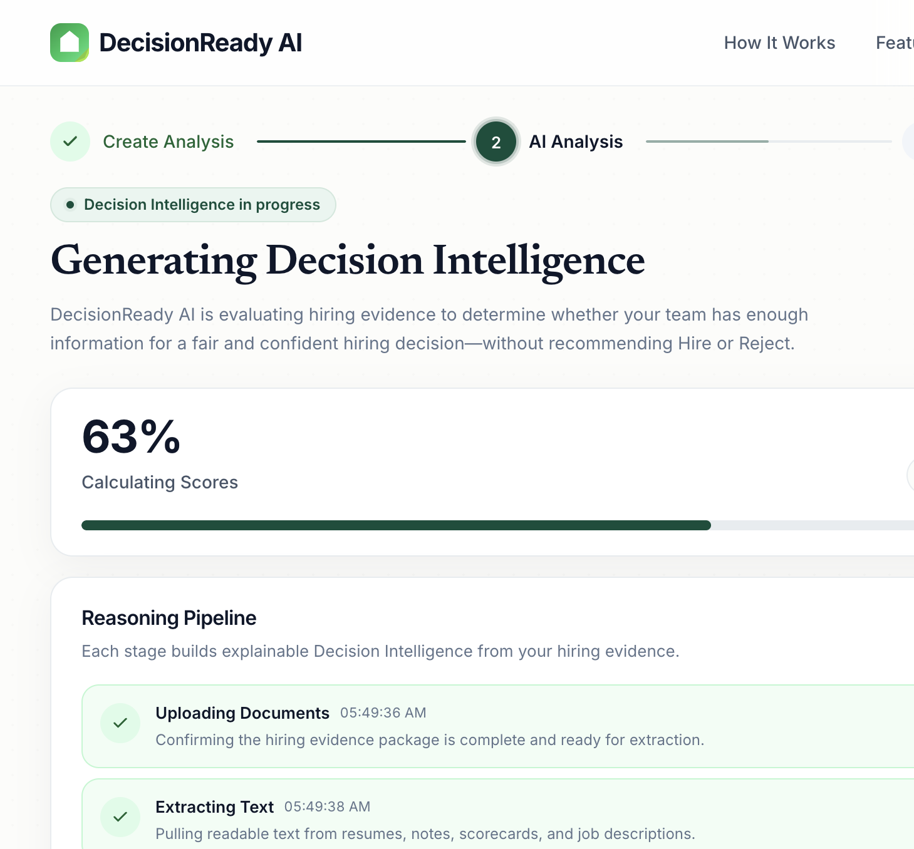

### Decision Intelligence Dashboard

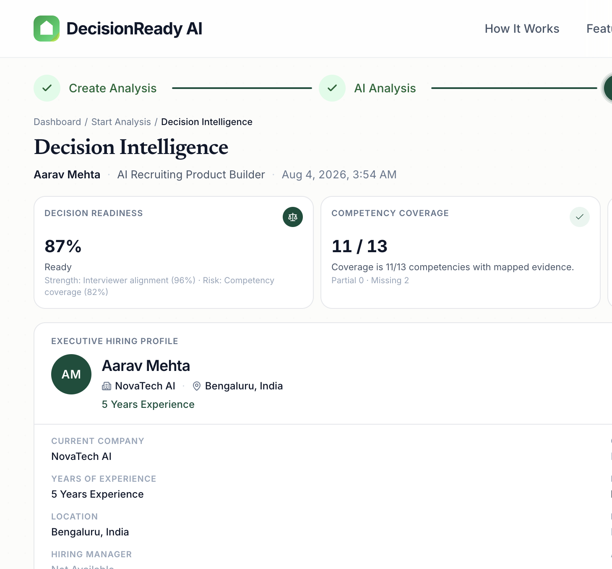

### Executive Hiring Profile

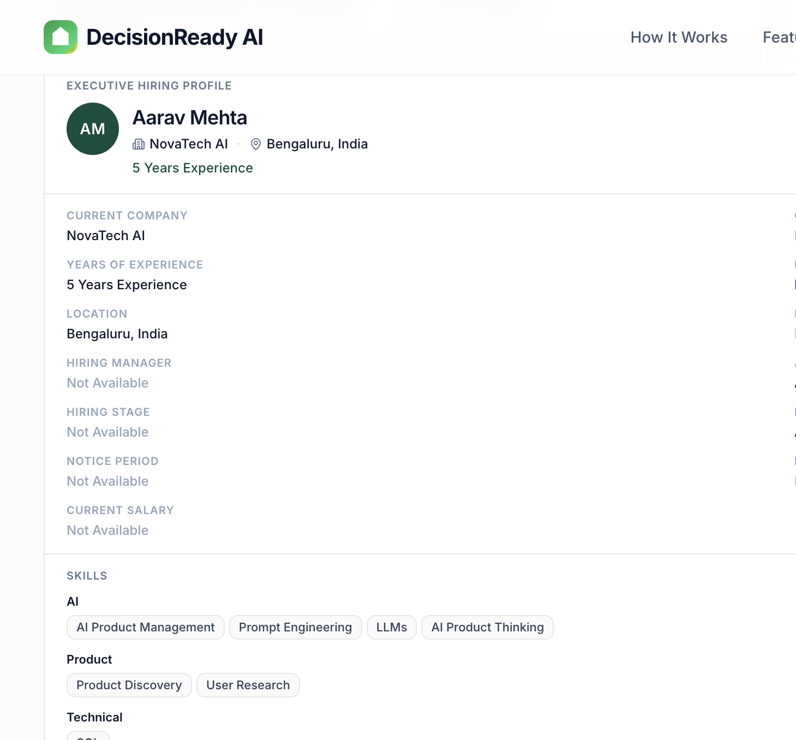

### Evidence Intelligence Matrix

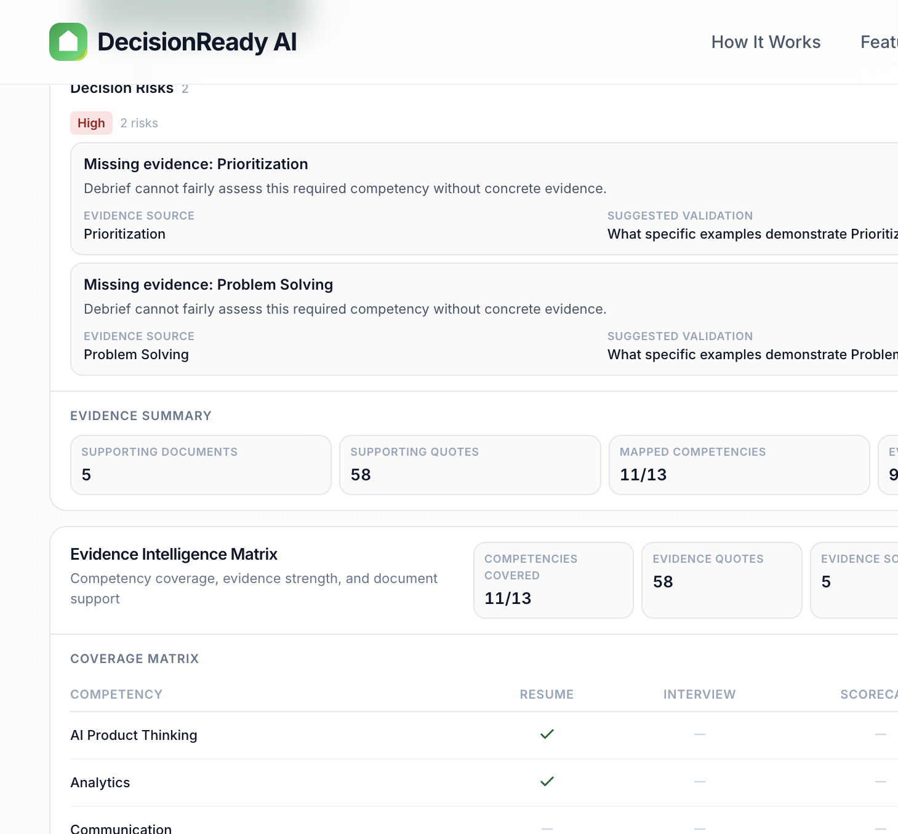

### Interactive Evidence Explorer

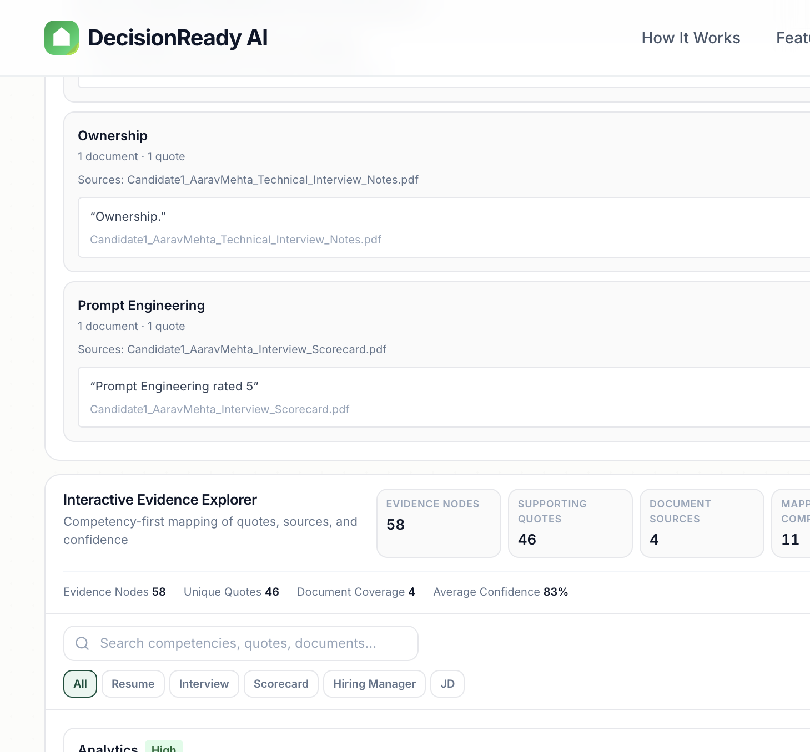

### AI Hiring Analyst (Recruiter Copilot)

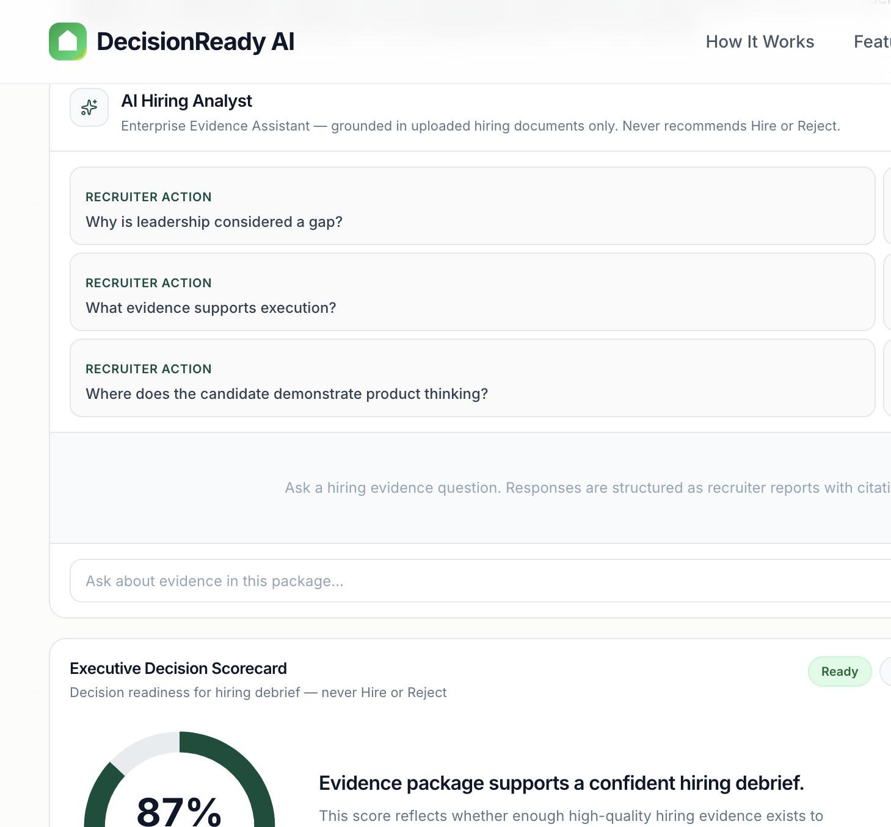

### Executive Decision Brief

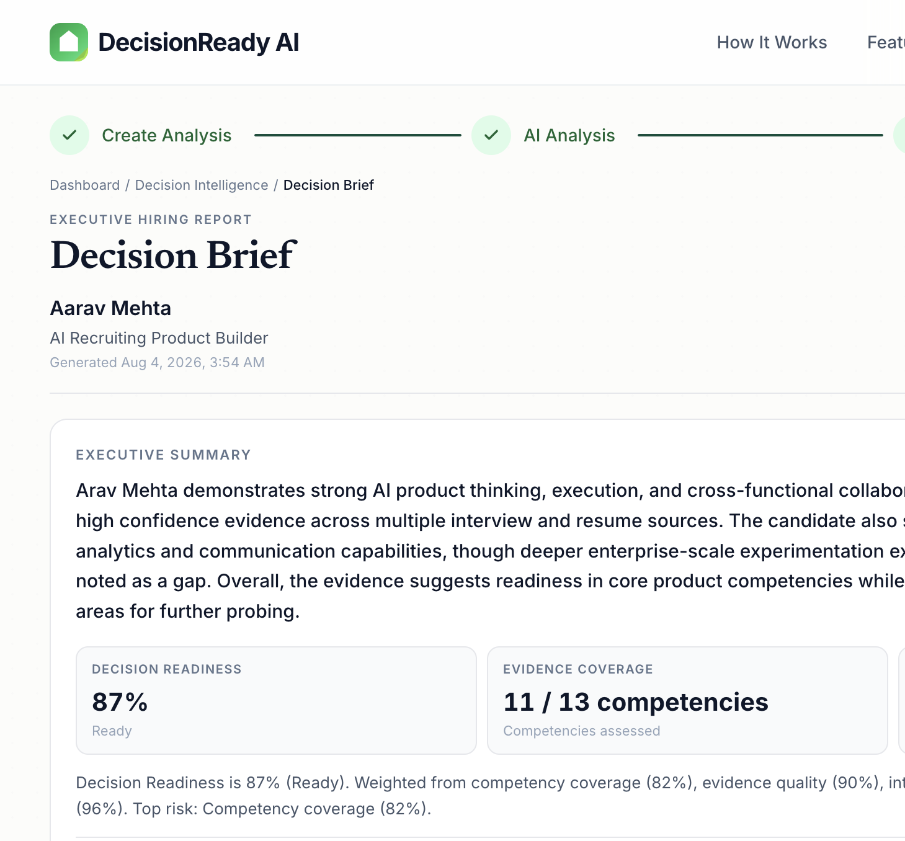

### Print Report Preview

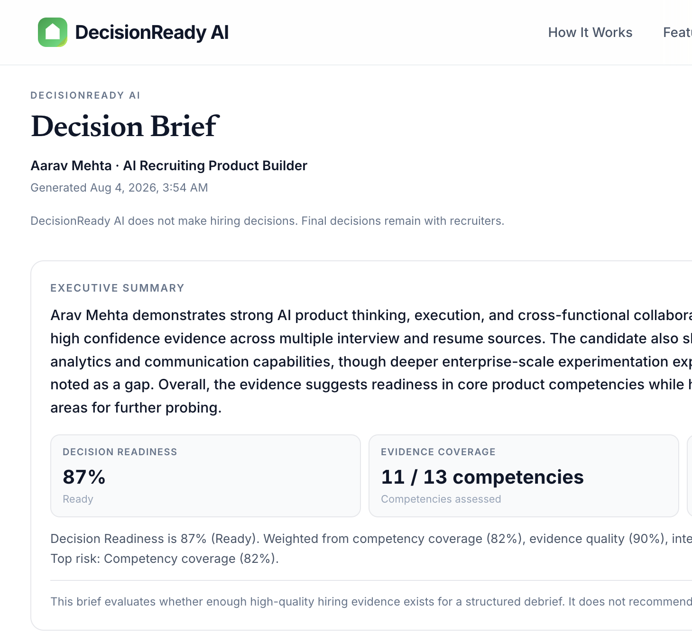

---

## Tech Stack

### Frontend

- **Next.js 15** (App Router, Turbopack)
- **React 19**
- **TypeScript**
- **Base UI / shadcn-style** components
- **Recharts** (readiness visuals)
- **Lucide React** icons

### Backend

- **Next.js Route Handlers** (`/api/analyses`, `/api/analyze`, `/api/copilot`)
- Local JSON persistence under `.data/` for Decision Analyses (MVP storage)

### AI Layer

- **Groq** via OpenAI-compatible client (`openai` SDK)
- Document extractors (JD, resume, interview notes, scorecards, manager notes)
- Evidence Graph merge + Decision Engine
- Zod schemas for structured outputs
- Copilot service with citation-aware responses

### Ingestion

- **pdf-parse** for PDF text
- **mammoth** for DOCX text

### Styling

- **Tailwind CSS 4**
- Custom landing / prepare / intelligence design tokens

### Deployment

- Standard Next.js deploy target (e.g. **Vercel**)
- Requires `GROQ_API_KEY` at runtime for intelligence generation

---

## Architecture

```text
Documents (PDF/DOCX)
        │
        ▼
┌───────────────────┐
│  Document Upload  │  Create Analysis + typed evidence slots
└─────────┬─────────┘
          ▼
┌───────────────────┐
│    Extractors     │  JD · Resume · Interview · Scorecard · HM Notes
└─────────┬─────────┘
          ▼
┌───────────────────┐
│  Evidence Graph   │  Competency nodes · quotes · citations · conflicts
└─────────┬─────────┘
          ▼
┌───────────────────┐
│  Decision Engine  │  Coverage · quality · alignment · completeness
│                   │  → Decision Readiness (no Hire/Reject)
└─────────┬─────────┘
          ▼
┌───────────────────┐
│ Shared Candidate  │  CandidatePresentationProfile (canonical fields)
│ Presentation Model│
└─────────┬─────────┘
          ▼
┌───────────────────┐
│ Presentation Layer│  Dashboard · Matrix · Explorer · Copilot · Brief · Print
└───────────────────┘
```

| Layer | Responsibility |
|---|---|
| **Document Upload** | Collect context + evidence package; validate formats and required JD |
| **Extractors** | Turn raw document text into structured signals |
| **Evidence Graph** | Merge multi-source evidence with competency links and citations |
| **Decision Engine** | Compute Decision Readiness and evidence gaps deterministically |
| **Shared Candidate Presentation Model** | Normalize profile fields for dashboard + brief |
| **Presentation Layer** | Recruiter-facing intelligence UI and printable brief |

Product principle: **Decision Support, not Decision Making.**

---

## Folder Structure

```text
.
├── docs/                         # Product & AI architecture docs + README screenshots
│   └── images/
├── public/                       # Static assets (logo, icons, manifest)
├── scripts/
│   └── capture-readme-screenshots.mjs
├── src/
│   ├── ai/                       # Analyze orchestration, schemas, prompts
│   ├── app/
│   │   ├── (marketing)/          # Landing page
│   │   ├── (app)/                # Dashboard
│   │   ├── (prepare)/            # Create · Analyzing · Intelligence · Brief
│   │   └── api/                  # Analyses, analyze, copilot APIs
│   ├── components/
│   │   ├── landing/
│   │   ├── prepare/
│   │   ├── analysis/
│   │   ├── intelligence/
│   │   ├── brief/
│   │   ├── dashboard/
│   │   ├── layout/
│   │   ├── shared/
│   │   └── ui/
│   ├── hooks/
│   └── lib/
│       ├── ai/                   # Provider, extractors, evidence graph, decision engine, copilot
│       ├── ingestion/            # PDF / DOCX text extraction
│       ├── types/
│       └── mock/
├── .env.example
├── package.json
└── tsconfig.json
```

---

## Running Locally

### Clone

```bash
git clone https://github.com/Rukhsar24081998/decisionready-ai.git
cd decisionready-ai
```

### Install

```bash
npm install
```

### Environment Variables

Copy the example file and add your Groq key:

```bash
cp .env.example .env.local
```

See [Environment Variables](#environment-variables).

### Development

```bash
npm run dev
```

Open [http://localhost:3000](http://localhost:3000).

### Lint

```bash
npm run lint
```

### Typecheck

```bash
npm run typecheck
```

### Build

```bash
npm run build
npm start
```

---

## Environment Variables

| Variable | Required | Description |
|---|---|---|
| `GROQ_API_KEY` | Yes | API key for Groq (Decision Intelligence + copilot) |
| `GROQ_MODEL` | No | Primary model (defaults per `.env.example`; provider may fall back if unavailable) |

Example (do **not** commit real secrets):

```bash
GROQ_API_KEY=your_api_key_here
GROQ_MODEL=openai/gpt-oss-120b
```

Keep secrets in `.env.local` only. `.env*` is gitignored.

---

## Future Roadmap

Realistic next steps for this MVP:

- Persistent cloud storage and multi-user auth (replace local `.data/` JSON)
- ATS connectors (Greenhouse / Lever / Ashby) for document sync
- Native PDF export (beyond browser print)
- Shareable report links with access control
- Deeper conflict resolution workflows for interviewer disagreement
- Evaluation harness for extractor + readiness regression tests
- Team workspaces and role-based permissions

---

## Limitations

Honest constraints of the current MVP:

- **No Hire / Reject recommendations by design** — readiness only
- **Local file-backed storage** (`.data/analyses.json`), not production multi-tenant persistence
- **No authentication / multi-user isolation** yet
- **LLM extraction quality depends on document clarity** and Groq availability
- **Share / PDF export** UI actions are partially “Coming soon”; print uses the browser print dialog
- **Not an ATS replacement** — Decision Intelligence layer only
- Screenshots and sample analyses use demo candidate packages for illustration

---

## Author

**Rukhsar Khan**  
Aspiring Product Manager · building AI-powered products with LLMs, React, and end-to-end product craft

- Portfolio: [rukhsar-khan-portfolio.vercel.app](https://rukhsar-khan-portfolio.vercel.app)
- GitHub: [github.com/Rukhsar24081998](https://github.com/Rukhsar24081998)
- LinkedIn: add your public profile URL here
- Email: [rukhsarkhan24081998@gmail.com](mailto:rukhsarkhan24081998@gmail.com)

---

Built for recruiters, hiring managers, product managers, and engineers who care about **evidence before opinion**.
